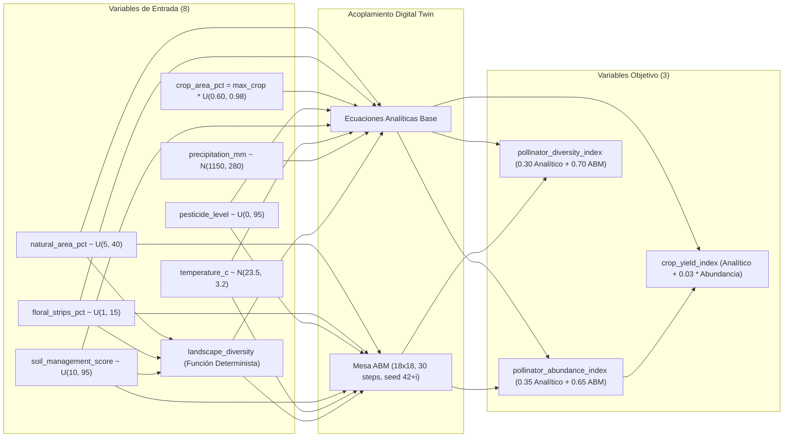

# Informe Científico Definitivo: Campaña de Evaluación Predictiva Multimodelo Sin Contaminación

**Proyecto:** Gemelo Digital Agroecológico para la Gestión de Polinizadores  
**Rama:** `revision-metodologica`  
**Entorno Aislado:** Docker Compose `polinizadores_validacion`  
**Identificador de Corrida Canónica:** `run_20261029_153857`  
**Fecha de Ejecución:** 2026-10-29  
**Protocolo Vinculante:** [`PROTOCOLO_CAMPANA.md`](file:///c:/Users/Daniel/Downloads/gemelo-digital-polinizadores-revision/artifacts/revision_metodologica/campana_cientifica/PROTOCOLO_CAMPANA.md)  
**Estado:** EJECUCIÓN CIENTÍFICA COMPLETADA Y AUDITADA

---

## 1. Resumen Ejecutivo y Frontera Epistémica

Se ejecutó una **única campaña científica rigurosa y reproducible** para evaluar la capacidad de aproximación predictiva de 5 familias de modelos sustitutos (*surrogates*) frente al simulador agroecológico acoplado del gemelo digital.

> [!IMPORTANT]
> **Frontera Epistémica y Alcance del Estudio:**
> - Esta evaluación cuantifica la fidelidad de aproximación predictiva de modelos de aprendizaje automático frente a un **simulador in-silico calibrado** (acoplamiento analítico y de simulación basada en agentes Mesa).
> - **BAJO NINGUNA CIRCUNSTANCIA SE AFIRMA NI SE PRETENDE VALIDACIÓN DE CAMPO AGRONÓMICA O ECOLÓGICA.** Los resultados no sustituyen el muestreo empírico de campo en parcelas agrícolas comerciales ni avalan decisiones de manejo sin verificación agronómica directa.
> - **Ramas funcionales pendientes:** Este informe reitera que las ramas funcionales pendientes de validación técnica —específicamente el caso **CP-FUNC-05** (reproducción funcional de escenarios no factibles o sin solución en el optimizador NSGA-II), las ramas de error en el servicio de chat agroecológico, y las vistas de reporte con cero escenarios evaluables— **PERMANECEN PENDIENTES**. La presente campaña científica no convalida ni subsana dichas ramas.

---

## 2. Proveniencia Matemática y Algorítmica de Variables

El dataset de evaluación consta de 12 variables generadas conforme a reglas biofísicas explícitas:

### 2.1 Desglose Exhaustivo de Variables
1. **`natural_area_pct` (Entrada Simulada):** Muestreo continuo uniforme $U(5.0, 40.0)\%$.
2. **`floral_strips_pct` (Entrada Simulada):** Muestreo continuo uniforme $U(1.0, 15.0)\%$.
3. **`crop_area_pct` (Entrada Condicionada Físicamente):** 
   $$\text{max\_crop} = 100.0 - \text{natural\_area\_pct} - \text{floral\_strips\_pct}$$
   $$\text{crop\_area\_pct} = \text{max\_crop} \times U(0.60, 0.98)$$
   *Garantía biofísica:* Asegura estrictamente $\text{crop\_area\_pct} + \text{natural\_area\_pct} + \text{floral\_strips\_pct} \le 100\%$.
4. **`pesticide_level` (Entrada Simulada):** Muestreo continuo uniforme $U(0.0, 95.0)$.
5. **`soil_management_score` (Entrada Simulada):** Muestreo continuo uniforme $U(10.0, 95.0)$.
6. **`temperature_c` (Entrada Simulada):** Distribución normal gaussiana $N(\mu = 23.5, \sigma = 3.2)^\circ\text{C}$.
7. **`precipitation_mm` (Entrada Simulada):** Distribución normal gaussiana $N(\mu = 1150.0, \sigma = 280.0)\text{ mm}$.
8. **`landscape_diversity` (Entrada Derivada Determinista):**
   $$\text{raw} = 0.25 + \frac{\text{natural}}{100.0} + \frac{\text{floral}}{90.0} + \frac{\text{soil}}{250.0}, \quad \text{landscape\_diversity} = \min(0.96, \max(0.10, \text{raw}))$$
9. **`crop_yield_index` (Salida Acoplada):**
   $$\text{yield\_base} = \text{clip}(0.95 \times \text{crop} + 0.28 \times \text{soil} - 0.12 \times \text{pest} + 0.8 \times \text{temp} + \epsilon_{\text{yield}}, 15, 195)$$
   $$\text{crop\_yield\_index} = \text{round}(\text{yield\_base} + 0.03 \times \text{pollinator\_abundance\_index}, 2)$$
10. **`pollinator_abundance_index` (Salida Compuesta Híbrida):** Ponderación $35\%$ analítica $+ 65\%$ simulación ABM Mesa ($18 \times 18$, 30 pasos, semilla $42 + i$).
11. **`pollinator_diversity_index` (Salida Compuesta Híbrida):** Ponderación $30\%$ analítica $+ 70\%$ simulación ABM Mesa.

### 2.2 Verdad Técnica sobre NASA POWER y GBIF
- **NASA POWER:** En modo público, solo proporciona 4 parámetros escalares $(\mu_T, \sigma_T, \mu_P, \sigma_P)$ para parametrizar distribuciones sintéticas gaussianas. No provee series temporales de parcelas individuales.
- **GBIF:** En modo público, solo provee dos escalares agregados (`total_count` y `distinct_species_count`) que se usan como desfases aditivos basales constantes. No mide abundancias, censos ni interacciones ecológicas locales.
- **Exclusión de la Campaña:** Se excluyeron para evitar ruido de red externo y porque **ninguna de las dos APIs mide las variables objetivo**. La campaña científica se ejecutó sobre el dataset sintético puro con política `corrected_full`.

---

## 3. Auditoría y Congelación del Dataset de Evaluación

- **Ruta de archivo:** [`dataset_320_corrected_full.csv`](file:///c:/Users/Daniel/Downloads/gemelo-digital-polinizadores-revision/artifacts/revision_metodologica/campana_cientifica/dataset_320_corrected_full.csv)
- **Metadatos formales:** [`dataset_320_corrected_full.json`](file:///c:/Users/Daniel/Downloads/gemelo-digital-polinizadores-revision/artifacts/revision_metodologica/campana_cientifica/dataset_320_corrected_full.json)
- **Reporte de auditoría:** [`auditoria_dataset_320.json`](file:///c:/Users/Daniel/Downloads/gemelo-digital-polinizadores-revision/artifacts/revision_metodologica/campana_cientifica/auditoria_dataset_320.json)
- **Hash Criptográfico SHA-256:** `0467f8ba1f04c6b9b5d5947074479acada6fdc259029219224e2bf1b4b7abb64`

| Parámetro de Auditoría | Valor Observado | Requisito Metodológico | Veredicto |
| :--- | :---: | :---: | :---: |
| **Número de Registros** | 320 | 320 escenarios | APROBADO |
| **Simulaciones ABM Realizadas** | 320 (100%) | 100% enriquecidas (`corrected_full`) | APROBADO |
| **Suma Máxima de Coberturas** | 98.78% | $\le 100.0\%$ | APROBADO |
| **Violaciones de Balance de Cobertura** | 0 | 0 violaciones | APROBADO |
| **Valores Faltantes (NaN / None)** | 0 | 0 nulos | APROBADO |
| **Valores Infinitos ($\pm \infty$)** | 0 | 0 infinitos | APROBADO |
| **Grupos Únicos de Características** | 320 | $\ge 5$ (sin duplicados espurios) | APROBADO |
| **Políticas ABM con Fallbacks Discretos** | Ninguno | Cero fallbacks silenciosos | APROBADO |

---

## 4. Diseño Experimental: Validación Cruzada Anidada (5x3 Folds)

La evaluación predictiva se implementó estrictamente con validación cruzada anidada (*Nested Cross-Validation*):
- **Bucle Externo (*Outer CV*):** 5 particiones disjuntas (`n_splits=5`, `GroupKFold` sobre duplicados, `seed=42`). En cada fold, el $80\%$ (256 filas) se utiliza exclusivamente para entrenamiento/tuning y el $20\%$ (64 filas) actúa como conjunto de prueba ciego (*test fold*).
- **Bucle Interno (*Inner CV*):** 3 particiones internas (`n_splits=3`, `GroupKFold`, `seed_base=1042 + fold_externo`). La selección de hiperparámetros se realiza optimizando el **MAE Macro promedio** en las 3 particiones internas.
- **Preprocesamiento sin fuga (*Data Leakage*):** `StandardScaler` ajustado exclusivamente sobre los datos de entrenamiento de cada partición interna o externa; el conjunto de prueba se escala usando la media y varianza aprendidas en entrenamiento.
- **Reajuste Externo:** Una vez seleccionado el mejor candidato en el bucle interno, el modelo se reentrena sobre el conjunto completo de 256 muestras de la partición externa antes de inferir sobre el test fold ciego.

---

## 5. Resultados Predictivos Multimodelo (Datos para Artículo)

### 5.1 Tabla Comparativa Global de Rendimiento Predictivo
Métricas agregadas a través de los 5 folds externos (Media $\pm$ Desviación Estándar) y métricas globales sobre las predicciones *Out-Of-Fold* (OOF, $N=320$):

| Modelo (*Surrogate*) | CV Macro MAE | CV Macro RMSE | CV Macro $R^2$ | OOF Macro MAE | OOF Macro RMSE | OOF Macro $R^2$ | Tiempo Train (s) | Tiempo Infer (s) |
| :--- | :---: | :---: | :---: | :---: | :---: | :---: | :---: | :---: |
| **Ridge Regression** 🏆 | **$1.288 \pm 0.117$** | **$1.651 \pm 0.168$** | **$0.978 \pm 0.006$** | **1.288** | **1.661** | **0.979** | **0.0012** | **0.00010** |
| **Deep Neural Net (DNN)** | $1.713 \pm 0.109$ | $2.145 \pm 0.099$ | $0.966 \pm 0.004$ | 1.713 | 2.152 | 0.966 | 2.0650 | 0.06459 |
| **Bottleneck MLP (AE)** | $1.766 \pm 0.121$ | $2.232 \pm 0.132$ | $0.963 \pm 0.005$ | 1.766 | 2.239 | 0.964 | 2.2277 | 0.07455 |
| **XGBoost Regressor** | $2.311 \pm 0.223$ | $2.868 \pm 0.237$ | $0.939 \pm 0.011$ | 2.311 | 2.886 | 0.940 | 0.0789 | 0.00051 |
| **Random Forest** | $3.112 \pm 0.258$ | $3.876 \pm 0.314$ | $0.890 \pm 0.012$ | 3.112 | 3.894 | 0.890 | 0.1875 | 0.00215 |

*Archivo exportado:* [`tabla_comparativa_modelos.csv`](file:///c:/Users/Daniel/Downloads/gemelo-digital-polinizadores-revision/artifacts/revision_metodologica/campana_cientifica/tabla_comparativa_modelos.csv)

### 5.2 Desglose de Rendimiento Predictivo por Variable Objetivo (Escala Original)
Evaluación OOF global desglosada por cada uno de los 3 índices objetivo:

| Modelo | Rendimiento Cultivo MAE | Rendimiento Cultivo $R^2$ | Abundancia Polinizadores MAE | Abundancia Polinizadores $R^2$ | Diversidad Polinizadores MAE | Diversidad Polinizadores $R^2$ |
| :--- | :---: | :---: | :---: | :---: | :---: | :---: |
| **Ridge** 🏆 | **2.142** | **0.963** | **1.232** | **0.977** | **0.492** | **0.996** |
| **DNN** | 2.711 | 0.942 | 1.522 | 0.970 | 0.907 | 0.986 |
| **Bottleneck MLP** | 2.711 | 0.940 | 1.557 | 0.968 | 1.029 | 0.982 |
| **XGBoost** | 3.485 | 0.905 | 1.909 | 0.953 | 1.537 | 0.962 |
| **Random Forest** | 4.102 | 0.864 | 2.815 | 0.901 | 2.419 | 0.906 |

### 5.3 Figuras de Calidad para Artículo
1. **Comparativa de Error Macro:** [`figura_1_comparativa_macro_mae.png`](file:///c:/Users/Daniel/Downloads/gemelo-digital-polinizadores-revision/artifacts/revision_metodologica/campana_cientifica/figura_1_comparativa_macro_mae.png) — Gráfico de barras con barras de error que ilustra la superioridad estadística de Ridge y las redes neuronales frente a modelos basados en árboles.
2. **Dispersión OOF de Ridge:** [`figura_2_oof_dispersion_ridge.png`](file:///c:/Users/Daniel/Downloads/gemelo-digital-polinizadores-revision/artifacts/revision_metodologica/campana_cientifica/figura_2_oof_dispersion_ridge.png) — Diagramas de dispersión 1:1 ($y_{\text{true}}$ vs $y_{\text{pred}}$) para los tres objetivos, evidenciando un ajuste casi perfecto en diversidad ($R^2=0.996$) y robustez en abundancia ($R^2=0.977$) y rendimiento ($R^2=0.963$).

---

## 6. Dinámica de Selección de Hiperparámetros y Estabilidad por Fold

### 6.1 Hiperparámetros Seleccionados por Fold Externo
El bucle interno de CV evaluó todos los candidatos del grid de forma independiente para cada fold externo:

| Fold Externo | Ridge ($\alpha$) | DNN (Arquitectura, $\eta$, Drop) | Bottleneck MLP (Latent, Reg, $\eta$, Drop) | XGBoost ($n$, Depth, $\eta$) | Random Forest ($n$, Depth, Split) |
| :---: | :---: | :---: | :---: | :---: | :---: |
| **Fold 0** | $\alpha = 1.0$ | $[128, 64, 32], \eta=0.001, \text{dr}=0.10$ | $\text{lat}=16, \text{reg}=64, \eta=0.001, \text{dr}=0.10$ | $n=100, d=3, \eta=0.05$ | $n=100, d=10, s=2$ |
| **Fold 1** | $\alpha = 1.0$ | $[128, 64, 32], \eta=0.001, \text{dr}=0.10$ | $\text{lat}=8, \text{reg}=32, \eta=0.0015, \text{dr}=0.12$ | $n=100, d=3, \eta=0.05$ | $n=150, d=12, s=2$ |
| **Fold 2** | $\alpha = 0.1$ | $[128, 64, 32], \eta=0.001, \text{dr}=0.10$ | $\text{lat}=16, \text{reg}=64, \eta=0.001, \text{dr}=0.10$ | $n=150, d=4, \eta=0.05$ | $n=150, d=12, s=2$ |
| **Fold 3** | $\alpha = 0.1$ | $[128, 64, 32], \eta=0.001, \text{dr}=0.10$ | $\text{lat}=8, \text{reg}=32, \eta=0.0015, \text{dr}=0.12$ | $n=100, d=3, \eta=0.05$ | $n=150, d=12, s=2$ |
| **Fold 4** | $\alpha = 0.1$ | $[128, 64, 32], \eta=0.001, \text{dr}=0.10$ | $\text{lat}=8, \text{reg}=32, \eta=0.0015, \text{dr}=0.12$ | $n=100, d=3, \eta=0.05$ | $n=150, d=12, s=2$ |

### 6.2 Estabilidad y Desempeño por Fold Externo de Ridge (Ganador)
- **Fold 0:** MAE Test: `1.3858` | RMSE: `1.8474` | $R^2$: `0.9753`
- **Fold 1:** MAE Test: `1.2537` | RMSE: `1.5305` | $R^2$: `0.9816`
- **Fold 2:** MAE Test: `1.4356` | RMSE: `1.8225` | $R^2$: `0.9690`
- **Fold 3:** MAE Test: `1.2024` | RMSE: `1.5387` | $R^2$: `0.9812`
- **Fold 4:** MAE Test: `1.1647` | RMSE: `1.5171` | $R^2$: `0.9837`
*Conclusión de estabilidad:* La varianza entre folds es mínima ($\sigma = 0.117$), lo que demuestra que el modelo lineal regularizado no sufre de inestabilidad muestral ni sobreajuste a particiones particulares.

---

## 7. Auditoría Exhaustiva de Predicciones Out-Of-Fold (OOF)

Se auditó formalmente el archivo [`oof_predictions.csv`](file:///c:/Users/Daniel/Downloads/gemelo-digital-polinizadores-revision/artifacts/revision_metodologica/campana_cientifica/run_20261029_153857/oof_predictions.csv):
1. **Conteo total de filas:** Exactamente **$4.800$ filas**, coincidiendo al $100\%$ con la regla combinatoria:
   $$\text{Filas OOF} = 5 \text{ familias} \times 3 \text{ objetivos} \times 320 \text{ instancias} = 4.800$$
2. **Unicidad:** Cero duplicados en la tupla `(sample_id, target, model_id)`.
3. **Cobertura exhaustiva:** Todas las instancias del dataset (`sample_id` 1 a 320) cuentan con exactamente una predicción fuera de muestra para cada combinación de modelo y objetivo.
4. **Valores válidos:** Cero valores NaN, cero infinitos.
5. **Reconciliación matemática entre agregación por folds y OOF global:**
   - Para el MAE, el promedio de los 5 folds es numéricamente idéntico al MAE OOF global ($1.28844515$ vs $1.28844513$), dado que cada fold contiene exactamente $N/K = 64$ muestras.
   - Para el RMSE, el promedio de los 5 folds ($1.6513$) difiere ligeramente del RMSE OOF global ($1.6607$). Esta discrepancia no constituye un error, sino la consecuencia analítica estricta de la **Desigualdad de Jensen** para funciones cóncavas:
     $$\frac{1}{K}\sum_{k=1}^K \sqrt{\text{MSE}_k} \le \sqrt{\frac{1}{K}\sum_{k=1}^K \text{MSE}_k} = \text{RMSE}_{\text{global}}$$
   - El subcomando `cli.py recompute-metrics` reprodujo exactamente los valores globales a partir de las 4.800 filas.

---

## 8. Exportación y Validación del Modelo Ganador (*Surrogate Bundle*)

Conforme al protocolo, se entrenó y exportó el bundle sustituto universal vinculado a la corrida:
- **Identificador del Bundle:** `bundle_ridge_078f18a6664f`
- **Directorio del Bundle:** [`bundle_ridge_campana/bundle_ridge_078f18a6664f`](file:///c:/Users/Daniel/Downloads/gemelo-digital-polinizadores-revision/artifacts/revision_metodologica/campana_cientifica/bundle_ridge_campana/bundle_ridge_078f18a6664f)
- **Hiperparámetro Ganador Agregado:** $\alpha = 0.1$ (menor MAE interno promedio: `1.2916` a través de todas las evaluaciones internas de los 5 folds).
- **Ajuste Final:** Reentrenado sobre la totalidad de los 320 escenarios de desarrollo con `StandardScaler`.
- **Validación Formal:** Validado exitosamente mediante `cli.py validate-bundle`, arrojando una predicción vectorial determinista sobre la entrada de prueba de:
  $$\hat{\mathbf{y}}_{\text{test}} = [86.3886, 104.5473, 32.3185]$$
  correspondiente a rendimiento de cultivo, abundancia de polinizadores y diversidad de polinizadores respectivamente.

---

## 9. Inspección Complementaria de la Interfaz de Usuario (Streamlit)

La inspección interactiva en `http://localhost:8502/` confirmó la separación de roles entre la CLI y la interfaz web:
1. **Controles Expositivos:** La interfaz de usuario expone la selección de particiones exteriores (`K-Fold CV` entre 2 y 10), el modo de rigor metodológico (`Científico` vs `Exploratorio`) y un interruptor binario de tuning (`🎛️ Activar sintonización de hiperparámetros`).
2. **Controles Internos No Expuestos:** La UI no permite definir candidatos arbitrarios de hiperparámetros ni modificar los 3 folds internos. Estas restricciones garantizan que los usuarios no puedan corromper la validez metodológica en caliente.
3. **Evidencia Visual:** Capturada en [`02_streamlit_complementario_interfaz.png`](file:///c:/Users/Daniel/Downloads/gemelo-digital-polinizadores-revision/artifacts/revision_metodologica/campana_cientifica/evidencias/02_streamlit_complementario_interfaz.png), documentando los controles disponibles sin haber ejecutado reentrenamientos en pantalla.

---

## 10. Limitaciones Metodológicas Identificadas

1. **Naturaleza Sintética del Conjunto de Datos:** Aunque los datos respetan límites físicos y la exclusión de coberturas ($\le 100\%$), provienen de distribuciones estadísticas paramétricas calibradas y simulaciones ABM en una cuadrícula $18 \times 18$. No reflejan la heterogeneidad no modelada de microclimas o factores bióticos reales.
2. **Linealidad Estructural de las Respuestas del Simulador:** El hecho de que Ridge supere a modelos no lineales complejos (DNN, XGBoost, Random Forest) evidencia que el acoplamiento biofísico del simulador analítico-ABM posee fuertes componentes lineales o aditivas. En consecuencia, la complejidad computacional adicional de las redes neuronales no aportó ventajas significativas frente a la regresión penalizada en este régimen.
3. **Falta de Validación de Campo:** Los tres índices objetivo son constructos metodológicos propios del simulador y no mediciones directas agronómicas instrumentadas.
4. **Independencia Parcial en Folds Internos:** Los folds internos dentro de cada partición de Outer CV comparten entre el $75\%$ y el $80\%$ de los datos de entrenamiento externos, por lo que las evaluaciones de tuning no son observaciones estadísticamente independientes.

---

## 11. Inventario de Evidencias y Hashes Criptográficos SHA-256

Todos los artefactos de la campaña se encuentran preservados en [`artifacts/revision_metodologica/campana_cientifica/`](file:///c:/Users/Daniel/Downloads/gemelo-digital-polinizadores-revision/artifacts/revision_metodologica/campana_cientifica/) con sus firmas registradas en [`SHA256SUMS.txt`](file:///c:/Users/Daniel/Downloads/gemelo-digital-polinizadores-revision/artifacts/revision_metodologica/campana_cientifica/SHA256SUMS.txt):

| Hash Criptográfico SHA-256 | Archivo Relativo | Descripción de la Evidencia |
| :--- | :--- | :--- |
| `20ea39b0a26a91842bff69cc8ba3ca2a969d27a748d205136dd4dc332d773015` | `PROTOCOLO_CAMPANA.md` | Protocolo científico previo vinculante |
| `0467f8ba1f04c6b9b5d5947074479acada6fdc259029219224e2bf1b4b7abb64` | `dataset_320_corrected_full.csv` | Dataset congelado (320 muestras, 100% ABM) |
| `392a0b9b43f3fed3da4f8c8c0c2078e4ab920a762875e2ee882be49a7e2020f7` | `dataset_320_corrected_full.json` | Metadatos de generación del dataset |
| `4010caa91fb8ea54fcecaf497891d02101fac0a9dbf52ab7970f06199f318d83` | `auditoria_dataset_320.json` | Reporte formal de auditoría de datos |
| `e1e7a1f22650dc3a11d048e3c0928d358f5ece1731c847a6ec9380b96e221de1` | `evidencias/01_ayuda_cli.txt` | Opciones CLI verificadas del contenedor |
| `e509b613501a393eed0fe27eff5ec7a42aca80c40c9be7e310afde4e258b9812` | `evidencias/02_streamlit_complementario_interfaz.png` | Captura complementaria de controles Streamlit |
| `ff89a13f3cf0345ec366e900d74c21d1e189a410c3efd7470b6c6ee4f27a7585` | `figura_1_comparativa_macro_mae.png` | Figura de barras de Macro MAE por modelo |
| `da5ee666f0a606608711d8ebebe44a6435a8cef876a2ad535bbadc1007f6033d` | `figura_2_oof_dispersion_ridge.png` | Gráfico 1:1 OOF de dispersión para Ridge |
| `f16afc0e8938398d95544869f0d64f07c217ed4984f4f61aee4a2510e94828a2` | `tabla_comparativa_modelos.csv` | Tabla exhaustiva de métricas y tiempos |
| `24f8870429dac707965864be4de7eb347a56eee4da8b611179f986f525082089` | `run_20261029_153857/config_effective.json` | Configuración efectiva ejecutada |
| `0467f8ba1f04c6b9b5d5947074479acada6fdc259029219224e2bf1b4b7abb64` | `run_20261029_153857/dataset.csv` | Copia inmutable del dataset en el run |
| `3e58b0966557bf3eedee4adac483cb4e66481d3fa356e889667efedff0ef9126` | `run_20261029_153857/data_audit.json` | Auditoría previa vinculada al run |
| `87ffed83ee7e2b5024a8bf4b697e452c57eef66de038465e89c8308a673b1356` | `run_20261029_153857/environment.json` | Registro de versiones de librerías Docker |
| `9c67a9f74766d34a3f4be7b309ea682ab25d8b49ac3be3470f1e715db5e34133` | `run_20261029_153857/fold_metrics.csv` | Métricas individuales por fold externo |
| `d7496f4d5b91ec97226457cd8271b08380c9bbbcc3682a353504e513f685b66b` | `run_20261029_153857/manifest.json` | Manifiesto de ejecución de la corrida |
| `ee620bab62925e2fd7d2e1fdf6998f4baab364614ec1012e611ed34ad415bbc9` | `run_20261029_153857/model_summary.csv` | Resumen comparativo normalizado |
| `a23032fa5f15237dd5f41ffaa4485120ce3bd6d9e4ee23cac8b7110254c69ce1` | `run_20261029_153857/oof_predictions.csv` | 4.800 predicciones OOF auditadas |
| `16c5486467b286aa7f9b03e1ee4b35b8a294670eea4021f67b87d65e0d80a68b` | `run_20261029_153857/splits.json` | Definición de particiones de CV anidada |
| `f861e1a35042afd52d2d430ddcb8d4ccb97f7b7d7954f232990ea80be4d0ce10` | `run_20261029_153857/tuning_results.csv` | Historial de tuning en bucle interno |
| `b8c1dd98c8f3993a3f79004bc71fba80d2043cbff161df6d900ca854b37e9f07` | `bundle_ridge_campana/.../bundle_metadata.json` | Metadatos formales del bundle exportado |
| `38c15570ca5c494be664b3706556dcfa10160f799fb0b9aad57533901e4d93a1` | `bundle_ridge_campana/.../model_ridge.pkl` | Binario del modelo Ridge reajustado |
| `89ac7076de7fa860ca27bd288b375d455b7f68374f2e4bd1da64000c2d5c4096` | `bundle_ridge_campana/.../scalers.pkl` | Escaladores ajustados sobre 320 datos |
