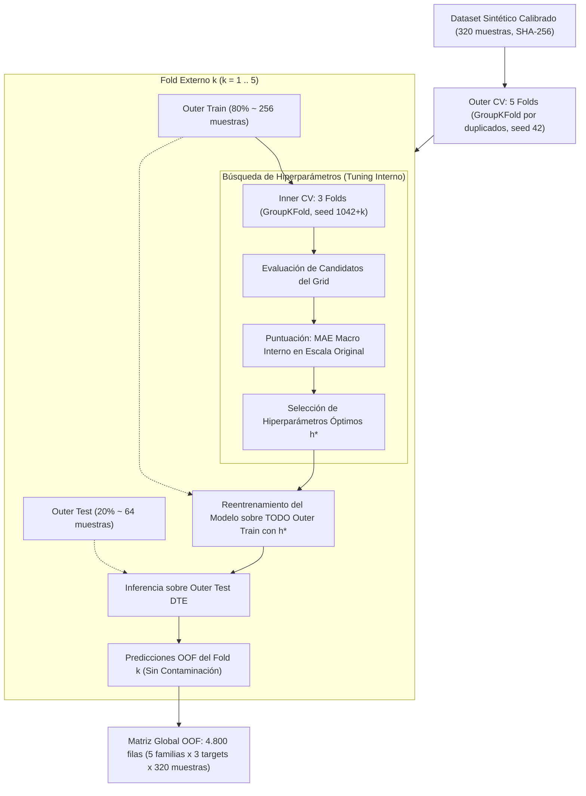

# Protocolo Metodológico: Campaña Científica de Evaluación Predictiva Multimodelo

**Proyecto:** Gemelo Digital Agroecológico para la Gestión de Polinizadores  
**Rama:** `revision-metodologica`  
**Entorno Aislado:** Docker Compose `polinizadores_validacion` (Red aislada: backend, frontend, streamlit, postgres)  
**Fecha de Emisión:** 2026-10-29  
**Versión de Protocolo:** 1.0_revision_metodologica  
**Estado:** REGISTRADO Y VINCULANTE (Fase previa a la ejecución)

---

## 1. Declaración de Alcance y Frontera Epistémica

> [!IMPORTANT]
> **Evaluación in-silico frente a simulador digital acoplado:**
> Esta campaña evalúa rigurosamente el rendimiento comparativo de 5 familias de modelos sustitutos (*surrogates*) frente a los escenarios sintéticos calibrados producidos por el modelo híbrido analítico-ABM del gemelo digital.
> **BAJO NINGUNA CIRCUNSTANCIA SE AFIRMA NI SE PRETENDE VALIDACIÓN DE CAMPO AGRONÓMICA O ECOLÓGICA.** Los resultados cuantifican la fidelidad de aproximación predictiva del sustituto con respecto al simulador generador, no la concordancia empírica con parcelas agrícolas reales no instrumentadas.

> [!WARNING]
> **Ramas funcionales pendientes:**
> Este protocolo registra que las ramas funcionales pendientes de validación técnica —específicamente el caso **CP-FUNC-05** (reproducción funcional de escenarios no factibles o sin solución en el optimizador NSGA-II), las ramas de error en el servicio de chat agroecológico, y las vistas de reporte con cero escenarios evaluables— **PERMANECEN PENDIENTES**. La realización de esta campaña científica predictiva no subsana, no valida ni aprueba dichas ramas de software.

---

## 2. Proveniencia Matemática y Algorítmica de Variables

El dataset sintético calibrado consta de 12 variables (8 entradas, 1 derivada determinista de paisaje y 3 variables objetivo acopladas). Su procedencia algorítmica y matemática se desglosa exhaustivamente a continuación:

### 2.1 Variables de Entrada Simuladas mediante Distribuciones Continuas

1. **`natural_area_pct` (Área Natural, %):**
   - *Procedimiento:* Muestreo pseudoaleatorio continuo uniforme:
     $$\text{natural\_area\_pct} \sim U(5.0, 40.0)$$
   - *Soporte biofísico:* $[5.0, 40.0]\%$, acotado en $[0, 100]\%$.
2. **`floral_strips_pct` (Franjas Florales, %):**
   - *Procedimiento:* Muestreo pseudoaleatorio continuo uniforme:
     $$\text{floral\_strips\_pct} \sim U(1.0, 15.0)$$
   - *Soporte biofísico:* $[1.0, 15.0]\%$, acotado en $[0, 100]\%$.
3. **`crop_area_pct` (Área de Cultivo, %):**
   - *Procedimiento:* Muestreo condicionado a la física de exclusión de coberturas:
     $$\text{max\_crop\_allowed} = 100.0 - \text{natural\_area\_pct} - \text{floral\_strips\_pct}$$
     $$\text{crop\_area\_pct} = \text{max\_crop\_allowed} \times U(0.60, 0.98)$$
   - *Garantía biofísica:* Asegura estrictamente que:
     $$\text{crop\_area\_pct} + \text{natural\_area\_pct} + \text{floral\_strips\_pct} \le 100.0\%$$
     evitando paisajes físicamente imposibles con coberturas superiores al 100%.
4. **`pesticide_level` (Carga de Agroquímicos / Pesticidas, índice 0-100):**
   - *Procedimiento:* Muestreo pseudoaleatorio continuo uniforme:
     $$\text{pesticide\_level} \sim U(0.0, 95.0)$$
5. **`soil_management_score` (Calidad de Manejo del Suelo, índice 0-100):**
   - *Procedimiento:* Muestreo pseudoaleatorio continuo uniforme:
     $$\text{soil\_management\_score} \sim U(10.0, 95.0)$$
6. **`temperature_c` (Temperatura Media Ambiental, °C):**
   - *Procedimiento:* Muestreo normal gaussiano representativo de pisos térmicos interandinos:
     $$\text{temperature\_c} \sim N(\mu = 23.5, \sigma = 3.2)$$
7. **`precipitation_mm` (Precipitación Anual Acumulada, mm):**
   - *Procedimiento:* Muestreo normal gaussiano:
     $$\text{precipitation\_mm} \sim N(\mu = 1150.0, \sigma = 280.0)$$

### 2.2 Variable de Entrada Derivada Determinista

8. **`landscape_diversity` (Índice de Heterogeneidad del Paisaje):**
   - *Procedimiento:* Función biofísica unificada que integra linealmente las coberturas y prácticas de conservación:
     $$\text{raw\_div} = 0.25 + \frac{\text{natural\_area\_pct}}{100.0} + \frac{\text{floral\_strips\_pct}}{90.0} + \frac{\text{soil\_management\_score}}{250.0}$$
     $$\text{landscape\_diversity} = \min\left(0.96, \max(0.10, \text{raw\_div})\right)$$
   - *Naturaleza:* Variable estrictamente derivada, reproducible y compartida de forma idéntica entre el generador sintético, el simulador ABM, el módulo de optimización NSGA-II y la inferencia en producción.

### 2.3 Variables Objetivo Compuestas (Acoplamiento Analítico-ABM)

9. **`crop_yield_index` (Rendimiento del Cultivo, índice):**
   - *Base analítica:*
     $$\text{yield\_base} = 0.95 \times \text{crop\_area\_pct} + 0.28 \times \text{soil\_management\_score} - 0.12 \times \text{pesticide\_level} + 0.8 \times \text{temperature\_c} + \epsilon_{\text{yield}}$$
     donde $\epsilon_{\text{yield}} \sim N(0, 2.5)$, acotada en $[15.0, 195.0]$.
   - *Acoplamiento biofísico post-ABM:*
     $$\text{crop\_yield\_index} = \text{round}(\text{crop\_yield\_base} + 0.03 \times \text{pollinator\_abundance\_index}, 2)$$
10. **`pollinator_abundance_index` (Abundancia Relativa de Polinizadores, índice):**
    - *Base analítica:*
      $$\text{ab\_base} = 1.6 \times \text{natural} + 2.8 \times \text{floral} - 0.75 \times \text{pesticide} + 0.35 \times \text{soil} + 22.0 \times \text{landscape\_diversity} + \epsilon_{\text{ab}}$$
      donde $\epsilon_{\text{ab}} \sim N(0, 3.5)$, acotada en $[5.0, 195.0]$.
    - *Salida simulador ABM (Mesa):* Abundancia media poblacional reescalada:
      $$\text{abm\_abundance} = \text{clip}(\text{mean\_population} \times 1.25, 8.0, 120.0)$$
    - *Salida compuesta final:* Ponderación híbrida:
      $$\text{pollinator\_abundance\_index} = \text{round}(0.35 \times \text{ab\_base} + 0.65 \times \text{abm\_abundance}, 2)$$
11. **`pollinator_diversity_index` (Diversidad de Polinizadores, índice):**
    - *Base analítica:*
      $$\text{div\_base} = 0.85 \times \text{natural} + 1.6 \times \text{floral} - 0.35 \times \text{pesticide} + 38.0 \times \text{landscape\_diversity} + \epsilon_{\text{div}}$$
      donde $\epsilon_{\text{div}} \sim N(0, 2.0)$, acotada en $[2.0, 98.0]$.
    - *Salida simulador ABM (Mesa):* Diversidad paisajística paramétrica:
      $$\text{abm\_diversity} = \text{clip}(8.0 + 0.38 \times \text{natural} + 0.55 \times \text{floral} + 14.0 \times \text{landscape\_diversity} - 0.08 \times \text{pesticide}, 4.0, 55.0)$$
    - *Salida compuesta final:* Ponderación híbrida:
      $$\text{pollinator\_diversity\_index} = \text{round}(0.30 \times \text{div\_base} + 0.70 \times \text{abm\_diversity}, 2)$$

---

## 3. Verdad Técnica sobre NASA POWER y GBIF

1. **NASA POWER API (`https://power.larc.nasa.gov/api/temporal/monthly/point`):**
   - *Qué aporta en el código:* Cuando se activa el modo público real, consulta la climatología mensual de una coordenada puntual para `T2M` (temperatura a 2 m) y `PRECTOTCORR` (precipitación corregida). Calcula la media muestral y la desviación estándar de la serie histórica $(\mu_T, \sigma_T, \mu_P, \sigma_P)$.
   - *Uso efectivo:* Dichos valores se usan exclusivamente como **parámetros de distribución** para generar valores sintéticos normales $N(\mu_T, \sigma_T)$ y $N(\mu_P, \sigma_P)$. No proporciona series temporales ni microclima a nivel de lote.
2. **GBIF Occurrence API (`https://api.gbif.org/v1/occurrence/search`):**
   - *Qué aporta en el código:* Consulta registros de ocurrencia taxonómica para la familia Apidae o el orden Hymenoptera en una caja delimitadora (*bounding box*). Extrae dos números enteros agregados: `total_count` (número total de registros) y `distinct_species_count` (número de especies observadas).
   - *Uso efectivo:* Se transforman en un **término independiente o desfase basal constante** mediante transformaciones logarítmicas o lineales:
     $$\text{base\_gbif\_abundance} = \text{clip}(25.0 + 6.5 \ln(1 + \text{total\_count}), 20.0, 65.0)$$
     $$\text{base\_gbif\_diversity} = \text{clip}(10.0 + 1.5 \times \text{distinct\_species\_count}, 8.0, 38.0)$$
   - *Limitación:* GBIF no mide abundancias censales locales, interacciones ecológicas ni dinámicas de lote; solo refleja esfuerzo de muestreo histórico.
3. **Justificación de Exclusión en la Campaña:**
   - Ni NASA POWER ni GBIF miden las variables objetivo (`crop_yield_index`, `pollinator_abundance_index`, `pollinator_diversity_index`).
   - La inclusión de llamadas de red no versionadas introduce latencias externas y sesgos geográficos no controlados.
   - La campaña científica se ejecuta estrictamente sobre el dataset sintético calibrado con física garantizada (`corrected_full`), asegurando reproducibilidad determinista al 100%.

---

## 4. Parámetros del Simulador ABM Efectivo

- **Motor de simulación:** Mesa (`PollinatorLandscapeModel`)
- **Espacio espacial:** Cuadrícula bidimensional discreta $18 \times 18$ (`MultiGrid(width=18, height=18, torus=False)`)
- **Pasos temporales (*steps*):** 30 pasos de simulación por escenario
- **Población inicial de agentes:** $\max(30, \lfloor 28 + 0.8 \times \text{natural\_area\_pct} \rfloor)$
- **Comportamiento de agentes:** Movimiento en vecindario de Moore hacia celdas de mayor densidad de recursos, consumo de recursos florales/naturales, decaimiento energético por riesgo de pesticidas, reproducción asexual condicional ($\text{energía} > 6.2$, $p_{\text{reprod}} \le 0.34$) y mortalidad biológica ($\text{energía} \le 0.35$).
- **Semilla pseudoaleatoria por escenario:** Determinista y desacoplada: $\text{seed}_i = 42 + i$ para $i \in [0, 319]$.
- **Política de enriquecimiento:** `corrected_full` (100% de las 320 filas enriquecidas mediante simulación ABM; sin enriquecimiento parcial).

---

## 5. Diseño de Evaluación: Validación Cruzada Anidada (Nested CV)

Para eliminar por completo la fuga de datos (*data leakage*) y el sesgo de optimismo en la selección de hiperparámetros, se fija el protocolo de validación cruzada anidada:

### 5.1 Especificación de Folds
- **Particiones Externas (*Outer Folds*):** $K_{\text{outer}} = 5$, `shuffle=True`, `seed=42`. Agrupación estricta de vectores idénticos mediante `GroupKFold` para evitar fuga por duplicados.
- **Particiones Internas (*Inner Folds*):** $K_{\text{inner}} = 3$, `shuffle=True`, `seed=1042`. Agrupación de duplicados en el conjunto de entrenamiento de cada fold externo.
- **Preprocesamiento:** Escalado estándar (`StandardScaler`) ajustado exclusivamente sobre los datos de entrenamiento de cada partición interna o externa, aplicando la transformación al conjunto de prueba sin recalcular parámetros.

### 5.2 Métrica Primaria y Criterio de Selección
- **Métrica Primaria:** `macro_mae` en unidades originales de los tres objetivos:
  $$\text{macro\_mae} = \frac{1}{3} \left( \text{MAE}(\text{crop\_yield}) + \text{MAE}(\text{pollinator\_abundance}) + \text{MAE}(\text{pollinator\_diversity}) \right)$$
- **Métrica de Desempate:** `macro_rmse` en unidades originales:
  $$\text{macro\_rmse} = \frac{1}{3} \left( \text{RMSE}(\text{crop\_yield}) + \text{RMSE}(\text{pollinator\_abundance}) + \text{RMSE}(\text{pollinator\_diversity}) \right)$$
- **Desempate Determinista Adicional:** Orden lexicográfico de la representación canónica JSON de los hiperparámetros.

---

## 6. Familias de Modelos, Candidatos y Presupuesto de Tuning

Se evalúan las 5 familias requeridas según la configuración congelada en `configs/revision_metodologica.json`:

| Familia | Identificador | N° Candidatos | Espacio de Búsqueda / Hiperparámetros | Presupuesto Computacional |
| :--- | :--- | :---: | :--- | :--- |
| **Ridge Regression** | `ridge` | 4 | $\alpha \in \{0.1, 1.0, 10.0, 50.0\}$ | Analítico directo |
| **Random Forest** | `random_forest` | 4 | 1) $n=50, d=6, s=2$ 2) $n=100, d=10, s=2$ 3) $n=100, d=\text{None}, s=5$ 4) $n=150, d=12, s=2$ | CPU multinúcleo ($n\_jobs=1$ estricto para determinismo) |
| **XGBoost** | `xgboost` | 4 | 1) $n=50, d=3, \eta=0.05$ 2) $n=100, d=3, \eta=0.05$ 3) $n=100, d=5, \eta=0.03$ 4) $n=150, d=4, \eta=0.05$ | Gradient Boosting en CPU |
| **Deep Neural Net** | `dnn` | 3 | 1) $[64, 64, 32], \eta=0.0015, \text{drop}=0.12$ 2) $[128, 64, 32], \eta=0.0010, \text{drop}=0.10$ 3) $[64, 32, 16], \eta=0.0020, \text{drop}=0.15$ | Épocas máx: 30, batch: 24, patience: 5, monitor split: 0.20 |
| **Bottleneck MLP** | `autoencoder_mlp` | 3 | 1) $\text{lat}=16, \text{reg}=64, \eta=0.0010, \text{drop}=0.10$ 2) $\text{lat}=8, \text{reg}=32, \eta=0.0015, \text{drop}=0.12$ 3) $\text{lat}=24, \text{reg}=64, \eta=0.0008, \text{drop}=0.08$ | Épocas máx: 30, batch: 24, patience: 5, monitor split: 0.20 |

*Nota semántica:* La arquitectura `autoencoder_mlp` opera como un perceptrón multicapa con cuello de botella (*bottleneck*) supervisado, entrenado de extremo a extremo sin reconstrucción no supervisada de entradas.

---

## 7. Acotamiento de Optimización Multiobjetivo Posterior

Dado que los casos de prueba de optimización científica multiobjetivo no se encuentran previamente especificados en las configuraciones del repositorio para un diseño experimental formal, **la optimización multiobjetivo se mantiene como PENDIENTE de protocolo específico de optimización**, a fin de no improvisar escenarios arbitrarios sin respaldo metodológico.

---

## 8. Verificación Técnica Previa de Tuning

Antes de iniciar la corrida formal de 320 muestras, se ejecuta una comprobación técnica acotada en `scratch/` sobre un micro-fixture sintético de 20 muestras ($K_{\text{outer}}=2, K_{\text{inner}}=2$, grid reducido) para certificar que el motor de validación interna y reajuste opera sin errores de ejecución en el contenedor aislado.

---

## 9. Compromisos de Conservación y Evidencia

La campaña generará y conservará:
1. `dataset_320_corrected_full.csv` con su correspondiente `dataset_320_corrected_full_metadata.json` y SHA-256 inmutable.
2. Reporte formal de auditoría de datos (`audit_dataset`).
3. Los 11 artefactos normalizados de la corrida nested CV (`run_manifest.json`, `split_definitions.json`, `fold_metrics.csv`, `oof_predictions.csv`, `tuning_results.csv`, `model_comparison.csv`, etc.).
4. Exactamente 4.800 predicciones OOF (5 familias $\times$ 3 objetivos $\times$ 320 muestras), verificando cobertura exhaustiva e índice de duplicados cero.
5. Verificación de concordancia mediante `recompute_metrics_from_oof`.
6. Evidencia visual complementaria en navegador sobre el entorno web sin re-ejecutar entrenamientos.
7. Acta e informe final consolidado con inventario de hashes SHA-256.
