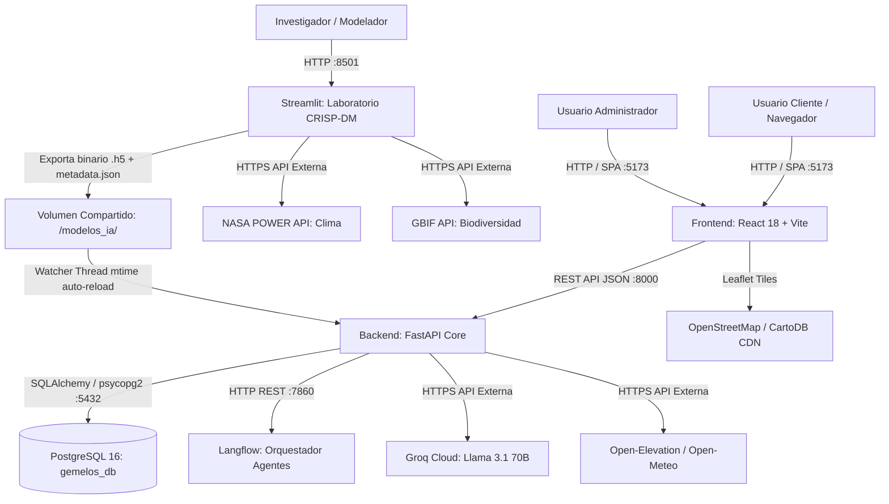

# Arquitectura de Software y Sistemas

**Documento:** `docs/arquitectura.md`  
**Referencia del commit analizado:** [`0d62f6634e1eb4a5066a2bd9e76efe2cb00fee02`](https://github.com/JMarkoFlores/gemelo-digital-polinizadores/commit/0d62f6634e1eb4a5066a2bd9e76efe2cb00fee02)  
**Evidencia principal:** [docker-compose.yml](../docker-compose.yml), [docker-compose.prod.yml](../docker-compose.prod.yml), [backend/app/main.py](../backend/app/main.py)

---

## 1. Visión General de la Arquitectura

La plataforma **Gemelos Digitales 02** se implementa bajo una arquitectura de microservicios contenerizados y desacoplados. La solución combina una interfaz de usuario web reactiva, un núcleo computacional analítico basado en FastAPI, una base de datos relacional para la persistencia transaccional y espacial, un entorno interactivo de experimentación científica en Streamlit, y un orquestador de agentes de lenguaje natural en Langflow.



---

## 2. Inventario y Rol de los Componentes

Archivo de respaldo: [docker-compose.yml:1-87](../docker-compose.yml#L1-L87)

### 2.1 Servicio `db` (Base de Datos Relacional)
- **Tecnología:** PostgreSQL 16 sobre imagen Alpine (`postgres:16-alpine`).
- **Puerto expuesto:** `5432:5432`.
- **Propósito:** Persistencia estructurada de credenciales de usuario y registros de simulaciones agroecológicas con geometrías GeoJSON y frentes de Pareto completos.
- **Healthcheck:** Evaluado mediante `pg_isready` cada 10 segundos ([docker-compose.yml:13-17](../docker-compose.yml#L13-L17)).

### 2.2 Servicio `backend` (Motor Analítico y API REST)
- **Tecnología:** Python 3.11-slim, FastAPI 0.115.0, Uvicorn, SQLAlchemy 2.0.35, TensorFlow 2.17.1, Pymoo 0.6.1.3, Shapely 2.0.6.
- **Puerto expuesto:** `8000:8000` (configurable mediante `BACKEND_PORT`).
- **Propósito:**
  - Control de acceso y autenticación mediante JWT (HS256).
  - Verificación espacial de coordenadas contra límites agroecológicos (*Domain Shift*).
  - Inferencia del metamodelo subrogado en memoria con recarga automática sin reinicio.
  - Ejecución del algoritmo genético multiobjetivo **NSGA-II** (`pymoo`).
  - Obtención de cotas altimétricas reales para diorama topográfico.
  - Generación de reportes ejecutivos operativos y de gestión.
  - Chatbot agronómico contextual con integración a PostgreSQL y Groq.

### 2.3 Servicio `frontend` (Interfaz Web de Usuario)
- **Tecnología:** Node 20 / Vite 5, React 18.3.1, TailwindCSS 3.4.13, Leaflet 1.9.4, Three.js 0.169.0 (`@react-three/fiber`, `@react-three/drei`), Recharts 2.12.7, jsPDF, docx, xlsx.
- **Puerto expuesto:** `5173:5173` (configurable mediante `FRONTEND_PORT`).
- **Propósito:** Consola web que permite a los agricultores y gestores dibujar parcelas en mapas interactivos, configurar escenarios climáticos y de pesticidas, explorar el Frente de Pareto, manipular maquetas 3D con relieve real y descargar informes ejecutivos.

### 2.4 Servicio `streamlit` (Laboratorio Científico CRISP-DM)
- **Tecnología:** Python 3.11, Streamlit 1.38.0, TensorFlow 2.17.1, Mesa 2.3.4, Scikit-Learn 1.5.2, XGBoost 2.1.1, Scikit-Posthocs 0.17.0.
- **Puerto expuesto:** `8501:8501` (configurable mediante `STREAMLIT_PORT`).
- **Propósito:** Entorno visual para científicos de datos. Permite la ingesta de datasets sintéticos y públicos (NASA POWER / GBIF), la simulación estocástica ABM de polinizadores, el entrenamiento multimodelo, la validación estadística inferencial (Friedman/Nemenyi) y la exportación de modelos entrenados a `/modelos_ia/`.

### 2.5 Servicio `langflow` (Orquestador Visual de Agentes IA)
- **Tecnología:** `langflowai/langflow:latest`.
- **Puerto expuesto:** `7860:7860` (configurable mediante `LANGFLOW_PORT`).
- **Propósito:** Ejecuta el flujo declarativo [asistente_recomendaciones_agroecologicas.json](../langflow/flows/asistente_recomendaciones_agroecologicas.json), estructurando justificaciones cualitativas sobre los trade-offs de la solución seleccionada frente a los extremos del Frente de Pareto.

---

## 3. Canales de Comunicación y Flujos de Datos

### 3.1 Frontend $\leftrightarrow$ Backend
- **Protocolo:** HTTP/1.1 con payloads JSON y cabeceras `Authorization: Bearer <token>`.
- **Políticas CORS:** Controladas en FastAPI a través de `CORSMiddleware`, configuradas mediante la variable de entorno `CORS_ORIGINS` (por defecto `http://localhost:5173,http://127.0.0.1:5173`) ([backend/app/main.py:64-70](../backend/app/main.py#L64-L70)).

### 3.2 Backend $\leftrightarrow$ PostgreSQL
- **Conector:** `psycopg2-binary` sobre dialecto `postgresql+psycopg2://`.
- **Gestión de Sesiones:** Pool administrado mediante SQLAlchemy `sessionmaker` con patrón de inyección de dependencias `get_db` ([backend/app/database.py](../backend/app/database.py)).

### 3.3 Streamlit $\leftrightarrow$ Backend (Desacoplamiento Asíncrono de Modelos)
- **Mecanismo:** Volumen compartido Docker denominado `modelos_ia_volume`.
- **Ruta interna:** `/modelos_ia/`.
- **Artefactos compartidos:**
  - `modelo_optimizado.h5`: Archivo HDF5 con la arquitectura y pesos de la red neuronal Keras.
  - `modelo_optimizado_metadata.json`: Metadatos de entrenamiento, columnas de entrada/salida, escaladores (`StandardScaler` mean y scale), y coordenadas del área agroecológica de validez.
- **Detección en Caliente (Hot-Reload):** El componente [model_store.py:41-86](../backend/app/services/model_store.py#L41-L86) del backend inicializa un hilo de ejecución en segundo plano (`model-watcher`) en el ciclo de vida de FastAPI (`lifespan`). Este hilo sondea cada 5 segundos la marca de tiempo de modificación (`st_mtime`) del archivo `.h5` y recarga automáticamente la red en memoria protegida por un cerrojo (`threading.Lock`), sin requerir el reinicio de ningún contenedor.

### 3.4 Backend $\leftrightarrow$ Langflow / Groq (Resiliencia en Cascada)
El servicio [recommendation_service.py](../backend/app/services/recommendation_service.py) asegura que el backend nunca interrumpa una simulación ante indisponibilidad de proveedores externos:
1. **Intento 1 (Langflow):** Invoca `POST http://langflow:7860/api/v1/run/{flow_id}` con un timeout estricto de 4.5 segundos.
2. **Intento 2 (Groq Directo):** Si Langflow no responde o no está disponible, consume directamente la API de Groq Cloud con el modelo `llama-3.1-70b-versatile`.
3. **Intento 3 (Fallback Heurístico Local):** Si no existe `GROQ_API_KEY` o hay fallo de red externa, ejecuta un motor determinista en Python que formatea cuantitativamente los deltas de rendimiento y polinizadores, garantizando que el usuario siempre reciba una explicación técnica basada en datos reales.

---

## 4. Almacenamiento Compartido y Persistencia

Archivo de respaldo: [docker-compose.yml:88-92](../docker-compose.yml#L88-L92)

```text
[Host Filesystem]
       │
       ├── postgres_data (Volumen Docker gestionado) ──> /var/lib/postgresql/data (db)
       │
       ├── modelos_ia_volume (Volumen Docker gestionado)
       │         ├── Montado en /modelos_ia/ (streamlit)  [Exporta modelo_optimizado.h5]
       │         └── Montado en /modelos_ia/ (backend)    [Importa modelo_optimizado.h5]
       │
       ├── langflow_data (Volumen Docker gestionado) ──> /app/langflow (langflow)
       │
       └── Carpetas montadas como bind-mounts locales:
                 ├── ./backend:/app (Recarga en caliente Uvicorn con --reload)
                 ├── ./frontend:/app (Vite HMR en modo desarrollo)
                 ├── ./streamlit_app:/app (Streamlit code watching)
                 └── ./langflow/flows:/app/flows (Esquemas JSON de flujos)
```

---

## 5. Control de Acceso y Modelo de Seguridad (RBAC)

Archivos de respaldo: [backend/app/security.py](../backend/app/security.py), [backend/app/dependencies.py](../backend/app/dependencies.py)

- **Cifrado de Contraseñas:** Algoritmo **bcrypt** implementado mediante `passlib.context.CryptContext(schemes=["bcrypt"])`.
- **Autenticación:** Tokens firmados **JWT (JSON Web Token)** con algoritmo HS256 y expiración configurable (default 60 minutos).
- **Roles del Sistema:**
  - `cliente`: Puede ejecutar simulaciones multiobjetivo, consultar su historial propio de corridas, descargar sus reportes y conversar con el chatbot respecto a sus propias parcelas. El backend deniega activamente el acceso de clientes a métricas globales de usuarios o simulaciones ajenas ([chat_service.py:135-158](../backend/app/services/chat_service.py#L135-L158)).
  - `admin`: Tiene acceso completo a la gestión de usuarios (CRUD), auditoría global de simulaciones y generación de reportes agregados operativos y agronómicos de toda la plataforma.
