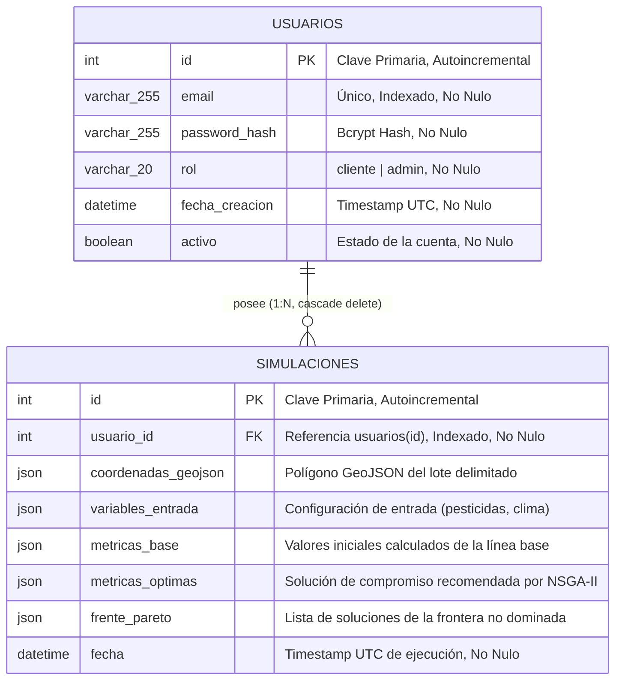

# Modelo de Datos y Persistencia Relacional

**Documento:** `docs/modelo-de-datos.md`  
**Referencia del commit analizado:** [`0d62f6634e1eb4a5066a2bd9e76efe2cb00fee02`](https://github.com/JMarkoFlores/gemelo-digital-polinizadores/commit/0d62f6634e1eb4a5066a2bd9e76efe2cb00fee02)  
**Evidencia principal:** [backend/app/models/user.py](../backend/app/models/user.py), [backend/app/models/simulation.py](../backend/app/models/simulation.py), [backend/app/database.py](../backend/app/database.py), [backend/app/seed.py](../backend/app/seed.py)

---

## 1. Visión General de la Persistencia

El almacenamiento relacional de la plataforma se apoya en **PostgreSQL 16** mediante el ORM **SQLAlchemy 2.0** en modo declarativo tipado (`Mapped`, `mapped_column`). El diseño combina campos tabulares estructurados para control de identidad y auditoría temporal, junto con columnas de tipo **`JSON`** nativo de PostgreSQL para almacenar geometrías espaciales GeoJSON, variables de configuración agroecológica y los conjuntos no dominados del Frente de Pareto.



---

## 2. Definición Detallada de Entidades

### 2.1 Entidad `Usuario` (Tabla `usuarios`)
Archivo de respaldo: [backend/app/models/user.py:9-20](../backend/app/models/user.py#L9-L20)

Almacena las cuentas de usuario y define el nivel de autorización en el sistema:

| Campo | Tipo SQLAlchemy / DB | Restricciones / Modificadores | Propósito |
| :--- | :--- | :--- | :--- |
| `id` | `Mapped[int]` / `INTEGER` | `primary_key=True`, `index=True` | Identificador único numérico autonumérico. |
| `email` | `Mapped[str]` / `VARCHAR(255)` | `unique=True`, `index=True`, `nullable=False` | Correo electrónico corporativo o personal, utilizado como identificador de login. |
| `password_hash` | `Mapped[str]` / `VARCHAR(255)` | `nullable=False` | Hash criptográfico generado mediante BCrypt (`passlib`). Nunca se almacena en texto plano. |
| `rol` | `Mapped[str]` / `VARCHAR(20)` | `nullable=False`, default="cliente" | Rol de control de acceso: `"admin"` o `"cliente"`. |
| `fecha_creacion` | `Mapped[datetime]` / `TIMESTAMP` | `nullable=False`, default=`datetime.utcnow` | Marca temporal UTC en la que se registró la cuenta. |
| `activo` | `Mapped[bool]` / `BOOLEAN` | `nullable=False`, default=`True` | Indicador de cuenta activa. Si es `False`, el endpoint de login bloquea el acceso (`403 Forbidden`). |

**Relación ORM:**
- `simulaciones`: Relación `1:N` bidireccional hacia la entidad `Simulacion`, configurada con `cascade="all, delete-orphan"`. Si un usuario es eliminado, PostgreSQL remueve automáticamente todas sus simulaciones para mantener integridad referencial.

---

### 2.2 Entidad `Simulacion` (Tabla `simulaciones`)
Archivo de respaldo: [backend/app/models/simulation.py:10-23](../backend/app/models/simulation.py#L10-L23)

Registra cada ejecución del motor de optimización multiobjetivo vinculada a un usuario:

| Campo | Tipo SQLAlchemy / DB | Restricciones / Modificadores | Propósito |
| :--- | :--- | :--- | :--- |
| `id` | `Mapped[int]` / `INTEGER` | `primary_key=True`, `index=True` | Identificador único de la simulación. |
| `usuario_id` | `Mapped[int]` / `INTEGER` | `ForeignKey("usuarios.id")`, `nullable=False`, `index=True` | Identificador del usuario propietario de la corrida. |
| `coordenadas_geojson` | `Mapped[dict[str, Any]]` / `JSON` | `nullable=False` | Polígono espacial en formato GeoJSON RFC 7946 que delimita la parcela o paisaje evaluado. |
| `variables_entrada` | `Mapped[dict[str, Any]]` / `JSON` | `nullable=False` | Parámetros de decisión suministrados por el usuario (nivel de pesticidas, área natural mínima y clima). |
| `metricas_base` | `Mapped[dict[str, Any]]` / `JSON` | `nullable=False` | Rendimiento agronómico y abundancia de polinizadores calculados en el escenario previo a la optimización. |
| `metricas_optimas` | `Mapped[dict[str, Any]]` / `JSON` | `nullable=False` | Variables de decisión y objetivos predichos para la mejor solución seleccionada del frente. |
| `frente_pareto` | `Mapped[list[dict[str, Any]]]` / `JSON` | `nullable=False` | Arreglo completo con las soluciones no dominadas generadas por el algoritmo NSGA-II. |
| `fecha` | `Mapped[datetime]` / `TIMESTAMP` | `nullable=False`, default=`datetime.utcnow` | Marca temporal UTC en la que se ejecutó la corrida analítica. |

**Relación ORM:**
- `usuario`: Relación `N:1` hacia la entidad `Usuario` mapeada mediante `back_populates="simulaciones"`.

---

## 3. Estructura y Validación de los Campos Semiestructurados (`JSON`)

### 3.1 Estructura de `coordenadas_geojson`
Formato estándar GeoJSON de tipo `Polygon`:
```json
{
  "type": "Polygon",
  "coordinates": [
    [
      [-78.9500, -8.1200],
      [-78.8800, -8.1200],
      [-78.8800, -8.0500],
      [-78.9500, -8.0500],
      [-78.9500, -8.1200]
    ]
  ]
}
```

### 3.2 Estructura de `variables_entrada`
Parámetros validados previamente por Pydantic ([SimulationRequest](../backend/app/schemas.py#L73-L79)):
```json
{
  "geometry": { "type": "Polygon", "coordinates": [...] },
  "bbox": [-78.95, -8.12, -78.88, -8.05],
  "pesticide_level": 25.0,
  "min_natural_area_pct": 20.0,
  "climate_scenario": "current"
}
```

### 3.3 Estructura de `metricas_base` y `metricas_optimas`
Refleja el contrato de 8 entradas y 3 salidas del metamodelo, enriquecido con datos espaciales:
```json
{
  "crop_area_pct": 65.5,
  "natural_area_pct": 24.5,
  "floral_strips_pct": 10.0,
  "pesticide_level": 2.5,
  "soil_management_score": 88.0,
  "temperature_c": 23.4,
  "precipitation_mm": 980.0,
  "landscape_diversity": 0.812,
  "crop_yield_index": 118.25,
  "pollinator_abundance_index": 106.67,
  "pollinator_diversity_index": 38.5,
  "selection_reason": "Justificación agronómica o técnica del trade-off...",
  "region_label": "-8.08,-78.91",
  "area_km2": 45.2
}
```

### 3.4 Estructura de `frente_pareto`
Lista de candidatos de Pareto ordenados por índice de abundancia de polinizadores:
```json
[
  {
    "crop_area_pct": 62.0,
    "natural_area_pct": 28.0,
    "floral_strips_pct": 10.0,
    "pesticide_level": 0.0,
    "soil_management_score": 92.0,
    "temperature_c": 23.4,
    "precipitation_mm": 980.0,
    "landscape_diversity": 0.84,
    "crop_yield_index": 115.4,
    "pollinator_abundance_index": 112.8,
    "pollinator_diversity_index": 42.1
  }
]
```

---

## 4. Ciclo de Vida y Gestión de Esquema

Archivo de respaldo: [backend/app/database.py](../backend/app/database.py), [backend/app/main.py:44-58](../backend/app/main.py#L44-L58)

- **Inicialización Automática:** El evento `lifespan` de FastAPI ejecuta `Base.metadata.create_all(bind=engine)`, garantizando que en el primer arranque de la plataforma se creen automáticamente las tablas faltantes sin intervención manual.
- **Herramientas de Migración:**  
  *Observación técnica `[CÓDIGO]` `[PENDIENTE DE VERIFICAR]`:* El repositorio **no contiene Alembic** ni archivos de migración de versiones de base de datos (`alembic.ini`). La evolución del esquema depende actualmente de la instrucción `create_all()`. Para entornos productivos con esquemas dinámicos, se recomienda incorporar Alembic en futuras fases.
