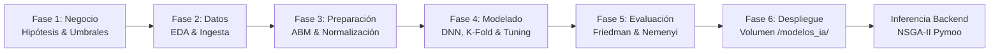

# Pipeline Científico, Modelado y Optimización Multiobjetivo

**Documento:** `docs/pipeline-cientifico.md`  
**Referencia del commit analizado:** [`0d62f6634e1eb4a5066a2bd9e76efe2cb00fee02`](https://github.com/JMarkoFlores/gemelo-digital-polinizadores/commit/0d62f6634e1eb4a5066a2bd9e76efe2cb00fee02)  
**Evidencia principal:** [streamlit_app/data_pipeline.py](../streamlit_app/data_pipeline.py), [streamlit_app/pollinator_abm.py](../streamlit_app/pollinator_abm.py), [streamlit_app/training.py](../streamlit_app/training.py), [streamlit_app/advanced_training.py](../streamlit_app/advanced_training.py), [streamlit_app/hyperparameter_tuning.py](../streamlit_app/hyperparameter_tuning.py), [backend/app/services/optimization.py](../backend/app/services/optimization.py)

---

## 1. Visión Metodológica (CRISP-DM)

El flujo científico de la plataforma está organizado en concordancia con el estándar metodológico **CRISP-DM** (*Cross-Industry Standard Process for Data Mining*), cubriendo de extremo a extremo el ciclo de vida del gemelo digital:

---

## 2. Ingesta y Preparación de Datos (Fases 2 y 3)

Archivo de respaldo: [streamlit_app/data_pipeline.py](../streamlit_app/data_pipeline.py)

### 2.1 Contrato Estricto de Variables

Para garantizar la interoperabilidad entre el laboratorio de entrenamiento y el motor de optimización del backend, todos los datasets deben cumplir rigurosamente el siguiente contrato de **8 variables de entrada** y **3 variables objetivo**:

| Tipo | Variable | Rango Esperado / Unidades | Descripción Agronómica / Ecológica |
| :--- | :--- | :--- | :--- |
| **Entrada (1)** | `crop_area_pct` | $[35.0, 82.0]\;\%$ | Porcentaje de superficie ocupada por cultivos comerciales. |
| **Entrada (2)** | `natural_area_pct` | $[8.0, 42.0]\;\%$ | Porcentaje de vegetación natural o bosque conservado. |
| **Entrada (3)** | `floral_strips_pct` | $[2.0, 18.0]\;\%$ | Porcentaje de bordes o corredores florales melíferos. |
| **Entrada (4)** | `pesticide_level` | $[5.0, 95.0]$ | Índice de intensidad de agroquímicos y plaguicidas. |
| **Entrada (5)** | `soil_management_score` | $[35.0, 95.0]$ | Puntuación de calidad biológica y prácticas de suelo. |
| **Entrada (6)** | `temperature_c` | Grados Celsius ($^\circ\text{C}$) | Temperatura media ambiental regional. |
| **Entrada (7)** | `precipitation_mm` | Milímetros anuales ($\text{mm}$) | Precipitación anual acumulada. |
| **Entrada (8)** | `landscape_diversity` | $[0.20, 0.96]$ | Índice de heterogeneidad del paisaje (fórmula unificada). |
| **Objetivo (1)** | `crop_yield_index` | Índice adecual $[20.0, 130.0]$ | Productividad y rendimiento de la cosecha. |
| **Objetivo (2)** | `pollinator_abundance_index` | Índice adecual $[8.0, 120.0]$ | Abundancia poblacional de insectos polinizadores. |
| **Objetivo (3)** | `pollinator_diversity_index` | Riqueza de especies $[5.0, 55.0]$ | Índice de diversidad o riqueza de especies observadas. |

#### Función Unificada de Diversidad Paisajística
Tanto el backend como el pipeline de entrenamiento calculan `landscape_diversity` mediante la misma formulación lineal acotada ([optimization.py:114-116](../backend/app/services/optimization.py#L114-L116)):
$$\text{landscape\_diversity} = \min\left(0.96,\; 0.25 + \frac{\text{natural\_area\_pct}}{100.0} + \frac{\text{floral\_strips\_pct}}{90.0} + \frac{\text{soil\_management\_score}}{250.0}\right)$$

### 2.2 Modalidades de Ingesta Soportadas
1. **Generador Sintético Estocástico:** ([data_pipeline.py:42-118](../streamlit_app/data_pipeline.py#L42-L118)): Simula variables climáticas mediante distribuciones normales y modela funciones de estrés hídrico y térmico sobre la respuesta de cultivos y polinizadores.
2. **Carga de CSV Propio:** Permite a investigadores cargar tablas CSV con sus propias mediciones de campo, validando automáticamente la presencia de las 11 columnas del contrato.
3. **Integración Pública Real (NASA POWER + GBIF):** ([data_pipeline.py:300-440](../streamlit_app/data_pipeline.py#L300-L440)): Consulta en vivo la API de NASA POWER para series de temperatura a 2m (`T2M`) y precipitación (`PRECTOTCORR`), y la API de GBIF para ocurrencias reales de *Apidae* / *Hymenoptera*, anclando empíricamente los niveles basales de abundancia y diversidad observada para regiones preconfiguradas (Valle del Cauca, Zona Cafetera, Cundiboyacá, Valle de Moche).
4. **Conectores Declarados Experimentales:** Las funciones para ERA5 (`cdsapi`) y Sentinel-2 (`earthengine-api`, `geemap`) existen como esqueletos de código, pero requieren instalación de paquetes pesados y credenciales privadas no disponibles en el contenedor base.

---

## 3. Simulación Basada en Agentes (ABM: Dinámica de Polinizadores)

Archivo de respaldo: [streamlit_app/pollinator_abm.py](../streamlit_app/pollinator_abm.py)

El módulo ABM utiliza el framework **Mesa 2.3.4** para simular explícitamente el forrajeo de polinizadores sobre una grilla espacial discreta:

- **Espacio:** Rejilla bidimensional `MultiGrid` de dimensiones configurables (por defecto $18 \times 18$ celdas) sin toroide (`torus=False`).
- **Mapeo de Hábitats:** Las celdas se dividen en `"crop"`, `"natural"` y `"floral"`. Las celdas naturales y florales regeneran recursos de polen y néctar a tasas de $0.24$ y $0.18$ unidades por paso temporal, mientras que las celdas de cultivo regeneran únicamente $0.08$.
- **Mapa de Peligro (Pesticidas):** El nivel de pesticidas impone un factor de toxicidad (`hazard_map`) mayor en celdas de cultivo ($0.35 + \text{pesticide}/150$) frente a zonas protegidas.
- **Agente (`PollinatorAgent`):**
  - Desplazamiento estocástico orientado: selecciona en su vecindad de Moore la celda vecina con mayor cantidad de recursos.
  - Balance metabólico: su energía se actualiza en cada paso como $\text{energía} \leftarrow \text{energía} + \text{recurso} - \text{hazard} - 0.4$.
  - Dinámica demográfica: si $\text{energía} > 6.2$, genera descendencia compartiendo el $55\%$ de su energía (con probabilidad ligada a la diversidad paisajística). Si $\text{energía} \le 0.35$, muere por toxicidad o inanición.
- **Enriquecimiento de Datasets:** La función `enrich_dataset_with_abm` ([pollinator_abm.py:151-193](../streamlit_app/pollinator_abm.py#L151-L193)) inyecta los resultados demográficos del ABM en el dataset de entrenamiento ponderando en un $65\%$ la abundancia simulada por agentes.

---

## 4. Metamodelo Subrogado y Entrenamiento (Fase 4)

Archivos de respaldo: [streamlit_app/training.py](../streamlit_app/training.py), [streamlit_app/advanced_training.py](../streamlit_app/advanced_training.py), [streamlit_app/hyperparameter_tuning.py](../streamlit_app/hyperparameter_tuning.py)

### 4.1 Arquitectura de la Red Neuronal (DNN Surrogate)
Dado que ejecutar el ABM espacial y modelos biofísicos para miles de candidatos en tiempo real sería computacionalmente inviable, se entrena una **red neuronal profunda sustituta (Surrogate Model)** que aproxima las relaciones no lineales en milisegundos:

- **Capa de Entrada:** 8 dimensiones con capa `keras.layers.Normalization(axis=-1)` adaptada sobre el conjunto de entrenamiento.
- **Capas Ocultas:**
  - Capa Densa 1: 64 neuronas, activación ReLU.
  - Capa Densa 2: 64 neuronas, activación ReLU.
  - Regularización: `Dropout(rate=0.12)`.
  - Capa Densa 3: 32 neuronas, activación ReLU.
- **Capa de Salida:** Densa de 3 neuronas con activación lineal (predice `crop_yield_index`, `pollinator_abundance_index`, `pollinator_diversity_index`).
- **Compilación:** Optimizador Adam con tasa de aprendizaje $\eta = 0.0015$, función de pérdida Error Cuadrático Medio (`loss="mse"`), evaluando Error Absoluto Medio (`metrics=["mae"]`).
- **Escalado de Salidas:** Se ajusta un `StandardScaler()` sobre los targets para normalizar la escala de las funciones objetivo durante el gradiente descendente.

### 4.2 Benchmark Multimodelo y Validación Cruzada
El sistema entrena y compara en paralelo **5 arquitecturas** evaluadas mediante validación cruzada estratificada $K$-Fold ($k=5$):
1. **DNN Surrogate (Híbrido)**: Red neuronal profunda descrita.
2. **Autoencoder + MLP (Híbrido)**: Codificador de reducción dimensional (32 $\rightarrow$ 16) acoplado a un regresor denso.
3. **Random Forest (Tradicional)**: Ensamblado de árboles (`n_estimators=100`, `max_depth=12`).
4. **XGBoost (Tradicional)**: Gradient boosting multi-salida (`n_estimators=100`, `learning_rate=0.08`).
5. **Ridge Regression (Tradicional)**: Regresión lineal regularizada L2 ($\alpha=1.0$).

### 4.3 Sintonización de Hiperparámetros (Tuning)
El módulo `hyperparameter_tuning.py` implementa una búsqueda sistemática para optimizar los hiperparámetros de cada familia de modelos antes de la evaluación final, utilizando búsqueda aleatoria (*RandomizedSearchCV*) para modelos tradicionales y búsqueda de arquitecturas neuronales (*NAS*) para Keras.

---

## 5. Optimización Multiobjetivo en Backend (NSGA-II)

Archivo de respaldo: [backend/app/services/optimization.py](../backend/app/services/optimization.py)

Una vez que el modelo es exportado a `/modelos_ia/` y cargado por el backend, se ejecuta la optimización ante cada petición en `POST /api/simular`.

### 5.1 Formulación Matemática del Problema
Se implementa la clase `LandscapeOptimizationProblem(Problem)` utilizando el framework **`pymoo`**:

- **Variables de Decisión ($n_{var} = 5$):**
  1. $x_1$: Porcentaje de cultivo comercial ($\text{crop\_area\_pct} \in [40, 85]$).
  2. $x_2$: Porcentaje de área natural ($\text{natural\_area\_pct} \in [\text{min\_natural\_area\_pct}, 45]$).
  3. $x_3$: Porcentaje de franjas florales ($\text{floral\_strips\_pct} \in [3, 20]$).
  4. $x_4$: Nivel de pesticidas ($\text{pesticide\_level} \in [0, 100]$).
  5. $x_5$: Índice de salud del suelo ($\text{soil\_management\_score} \in [45, 95]$).

- **Funciones Objetivo a Minimizar ($n_{obj} = 2$):**
  $$f_1(X) = - \text{crop\_yield\_index}(X)$$
  $$f_2(X) = - \text{pollinator\_abundance\_index}(X)$$
  *(Maximizar simultáneamente el rendimiento agrícola y la abundancia de polinizadores).*

- **Restricciones de Desigualdad ($n_{constr} = 2$, formuladas como $g(X) \le 0$):**
  1. Balance de Cobertura de Superficie:
     $$g_1(X) = (\text{crop\_area\_pct} + \text{natural\_area\_pct} + \text{floral\_strips\_pct}) - 100.0 \le 0$$
  2. Cumplimiento de Área Natural Protegida Mínima:
     $$g_2(X) = \text{min\_natural\_area\_pct} - \text{natural\_area\_pct} \le 0$$

### 5.2 Parámetros del Algoritmo Genético
- **Algoritmo:** Non-dominated Sorting Genetic Algorithm II (**NSGA-II**).
- **Tamaño de Población:** 64 individuos.
- **Generaciones:** 40 generaciones de evolución genética.
- **Semilla Estocástica:** $42$ para reproducibilidad determinista.

### 5.3 Selección de la Mejor Solución de Compromiso
Entre las soluciones no dominadas del Frente de Pareto resultante, el backend selecciona la solución recomendada evaluando una función de recompensa heurística ponderada ([optimization.py:268-274](../backend/app/services/optimization.py#L268-L274)):
$$\Delta \text{yield} = \text{yield}_{cand} - \text{yield}_{base}$$
$$\Delta \text{poll}_{\%} = \frac{\text{poll}_{cand} - \text{poll}_{base}}{\max(1.0, \text{poll}_{base})} \times 100$$
$$\text{bonus} = \begin{cases} 120.0 & \text{si } \Delta \text{yield} \ge 0 \;\land\; \Delta \text{poll}_{\%} \ge 20\% \\ 0.0 & \text{en caso contrario} \end{cases}$$
$$\text{Score} = \text{bonus} + \Delta \text{poll}_{\%} + 1.4 \times \Delta \text{yield} + 0.1 \times \text{pollinator\_diversity}_{cand}$$

La solución con mayor puntuación maximiza la probabilidad de confirmar la hipótesis científica del proyecto ($+20\%$ polinizadores protegiendo la productividad agrícola).
