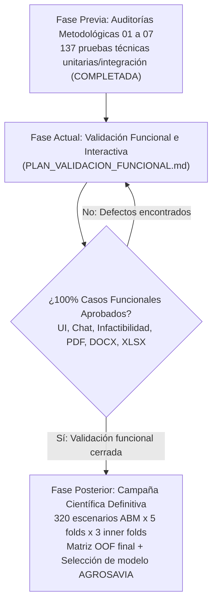

# Plan de Validación Funcional y de Consumidores Documentales

**Proyecto**: Gemelo Digital Agroecológico para Polinizadores — Revisión Metodológica  
**Rama Git**: `revision-metodologica`  
**Commit base**: `1ab7c02abc4176d8ec11c94db6e15c80a885f6ab`  
**Fecha de elaboración**: 28 de octubre de 2026  
**Responsable técnico**: Antigravity (Google DeepMind)  
**Destino de publicación científica**: Revista Ciencia y Tecnología Agropecuaria (AGROSAVIA)  
**Estado del protocolo**: APROBADO PARA EJECUCIÓN (Pruebas unitarias e integración de código 100% verificadas; ejecución interactiva y manual pendiente)

---

## 1. Introducción y Objetivos del Plan

Tras culminar las siete auditorías técnicas metodológicas (Auditorías 01 a 07) y verificar exhaustivamente el código mediante 132 pruebas automatizadas en contenedor Docker y 5 pruebas lógicas en Node.js, este documento formaliza el **Protocolo de Validación Funcional e Interactiva de Extremo a Extremo**.

### 1.1. Objetivo General
Validar experimentalmente en navegador y en entorno de ejecución integrado que los subsistemas del Gemelo Digital (entrenamiento en Streamlit, backend en FastAPI, interfaz de usuario en React, motor evolutivo NSGA-II y exportadores documentales) se comportan de forma robusta, reproducible y metodológicamente fidedigna ante interacciones de usuarios reales y casos de borde.

### 1.2. Separación Estricta de Fases
Es mandatorio distinguir formalmente dos procedimientos independientes:



1. **Validación Funcional (Alcance de este Plan)**: Comprueba la operatividad técnica completa, visualización interactiva, captura de errores, resiliencia ante entradas no admisibles, coherencia poblacional de reportes y la **generación física y revisión visual real de documentos descargados (Excel, PDF, Word)**. Utiliza corridas sintéticas pequeñas o bundles de prueba controlados para verificar flujos sin sobrecarga de cómputo.
2. **Campaña Científica Definitiva (Fase Posterior Autorizada)**: Corresponde a la ejecución de entrenamiento masivo con los 320 escenarios ABM en validación cruzada anidada estricta (5 folds externos, 3 internos), selección del modelo sustituto canónico para producción y cálculo de métricas definitivas de inferencia para el manuscrito científico de AGROSAVIA. **No forma parte de este plan funcional y no debe ejecutarse anticipadamente**.

---

## 2. Entorno, Servicios y URLs Requeridas

### 2.1. Especificación del Entorno
- **Sistema Operativo Anfitrión**: Windows 11 Pro / Enterprise x64.
- **Motor de Contenedores**: Docker Desktop / Docker Engine 29.x (modo contenedores Linux).
- **Aislamiento de Proyecto Docker Compose**: Nombre de proyecto aislado `polinizadores_revision`.
- **Navegadores Homologados para Prueba**:
  - Google Chrome (versión 120 o superior).
  - Mozilla Firefox (versión 125 o superior).

### 2.2. Mapa de Servicios y Puertos Parametrizados
Antes de iniciar la ejecución del plan, los servicios de la arquitectura deben desplegarse y comprobarse en los siguientes puntos de enlace:

| Servicio | Contenedor / Proceso | Puerto de Host | URL de Acceso | Comprobación de Salud |
|---|---|---|---|---|
| **Base de Datos** | `polinizadores_revision_db` (PostgreSQL 15) | `5433` | `localhost:5433` | `pg_isready -h localhost -p 5433 -U postgres` |
| **Backend API** | `polinizadores_revision_backend` (FastAPI) | `8001` | `http://localhost:8001` | `GET http://localhost:8001/api/v1/health` $\to$ `200 OK` |
| **Documentación API** | OpenAPI / Swagger | `8001` | `http://localhost:8001/docs` | Renderizado interactivo Swagger |
| **Frontend de Usuario** | `polinizadores_revision_frontend` (React + Vite) | `5174` | `http://localhost:5174` | Carga visual de la pantalla de inicio |
| **Estudio de Entrenamiento** | `polinizadores_revision_streamlit` (Streamlit) | `8502` | `http://localhost:8502` | Selector de modo AGROSAVIA visible |
| **Contenedor Científico** | `polinizadores_revision-scientific` | N/A (CLI) | N/A | `docker compose -p polinizadores_revision run --rm scientific python -V` |

---

## 3. Matriz de Casos de Prueba Funcionales

### Grupo 1: Entrenamiento, Persistencia, Exportación y Recarga de Modelos

#### CP-FUNC-01: Entrenamiento en Modo Científico Estricto con Semilla Personalizada
- **Objetivo**: Verificar que la interfaz de Streamlit ejecute el flujo científico sin fallos, aplique la semilla personalizada al reajuste final y persista la jerarquía de 11 artefactos.
- **Precondiciones**: Servicio Streamlit activo en `http://localhost:8502`.
- **Pasos**:
  1. Abrir `http://localhost:8502` en el navegador.
  2. En el panel lateral, seleccionar **"Modo Científico Estricto (AGROSAVIA)"**.
  3. Cargar el dataset de prueba o activar el generador con $N=30$ muestras (modo test).
  4. Ingresar la semilla pseudoaleatoria personalizada: `random_state = 1337`.
  5. Configurar folds externos $K=3$ e internos $k=2$. Seleccionar familias Ridge y Random Forest.
  6. Hacer clic en **"Entrenar y Evaluar Sustitutos"**.
- **Resultado Esperado**:
  - Barra de progreso avanza sin errores.
  - Se genera un directorio de ejecución: `artifacts/revision_metodologica/<run_id>/`.
  - El directorio contiene exactamente los 11 artefactos: `manifest.json`, `config_effective.json`, `splits.json`, `fold_metrics.csv`, `oof_predictions.csv`, `hyperparameter_evaluations.csv`, `evaluation_timings.csv`, `observed_training_ranges.json`, `data_audit_report.json`, modelo `.pkl` y `SHA256SUMS.txt`.
  - `config_effective.json` registra `"seed": 1337`.
  - `manifest.json` contiene `"final_seed": 1337` y estado `"completed"`.
- **Evidencia a Recopilar**:
  - Captura de pantalla de la tabla final de Streamlit con métricas y ganador.
  - Copia de `artifacts/revision_metodologica/<run_id>/manifest.json` y `config_effective.json`.

#### CP-FUNC-02: Exportación Vinculada de Bundle y Recarga Atómica en Backend
- **Objetivo**: Verificar que el bundle exportado incorpore la identidad canónica y se cargue en caliente en el backend invalidando cachés previas.
- **Precondiciones**: CP-FUNC-01 completado exitosamente. Backend activo en puerto 8001.
- **Pasos**:
  1. En la interfaz de Streamlit, dentro del panel de exportación del run completado, hacer clic en **"Exportar Modelo Seleccionado para Producción"**.
  2. Verificar en el sistema de archivos la creación de `modelos_ia/bundle_<familia>_<bundle_id>.zip` o directorio equivalente con su `bundle_metadata.json`.
  3. Ejecutar la recarga atómica vía HTTP:
     ```bash
     curl -X POST http://localhost:8001/api/v1/models/reload
     ```
  4. Consultar el estado activo del modelo en el backend:
     ```bash
     curl -X GET http://localhost:8001/api/v1/models/active
     ```
- **Resultado Esperado**:
  - `bundle_metadata.json` contiene `final_seed: 1337`, `schema_version: "2.0_revision_metodologica"`, rangos observados y `file_hashes` completos.
  - La llamada a `/models/reload` retorna HTTP 200 con el nuevo `bundle_id`.
  - La caché interna de simulaciones en memoria queda purgada (`simulation_cache.clear()`).
- **Evidencia a Recopilar**:
  - JSON de respuesta de `/api/v1/models/active`.
  - Archivo `bundle_metadata.json`.

---

### Grupo 2: Optimización Biofísica, Dominio y Manejo de Infactibilidad

#### CP-FUNC-03: Optimización Factible con Evaluación de Criterio Conjunto
- **Objetivo**: Validar el flujo completo de optimización evolutiva en la interfaz React, verificación del frente de Pareto y presentación unívoca del criterio conjunto.
- **Precondiciones**: Frontend activo en `http://localhost:5174`. Bundle cargado en backend.
- **Pasos**:
  1. Abrir `http://localhost:5174` e iniciar sesión con usuario estándar.
  2. Navegar a **"Nueva Simulación / Optimización"**.
  3. Configurar una parcela con parámetros válidos dentro de los rangos observados:
     - Área de cultivo: 60.0%
     - Área natural: 25.0%
     - Franjas florales: 10.0% (Suma = 95.0% $\le 100\%$)
     - Temperatura media: 21.5 °C, Precipitación: 850 mm.
  4. Ejecutar **"Iniciar Optimización Agroecológica"**.
- **Resultado Esperado**:
  - La optimización NSGA-II finaliza en tiempo razonable.
  - Se despliega el gráfico interactivo del frente de Pareto con los puntos no dominados.
  - La tarjeta de recomendación despliega los deltas óptimos de rendimiento y polinizadores.
  - Si $\Delta \text{Rendimiento} \ge 0.0$ y $\Delta \text{Polinizadores} \ge +20.0\%$, se muestra con claridad el banner:  
    `"Criterio operativo de mejora conjunta cumplido"`.
  - No aparece ninguna afirmación desmedida de validación empírica o ecológica de campo.
- **Evidencia a Recopilar**:
  - Captura de pantalla de la pantalla de resultados con el frente de Pareto y el banner de criterio.

#### CP-FUNC-04: Rechazo Bloqueante ante Violación de Restricciones Físicas y de Dominio
- **Objetivo**: Confirmar que el sistema impida simulaciones fuera del dominio biofísico o con coberturas matemáticamente imposibles.
- **Precondiciones**: Frontend activo en `http://localhost:5174`.
- **Pasos**:
  1. Intentar configurar una parcela donde la suma de coberturas supere el 100%:
     - Cultivo: 70%, Natural: 30%, Franjas: 15% (Suma = 115%).
  2. Intentar ingresar temperaturas o precipitaciones por fuera de los rangos empíricos observados del modelo activo.
  3. Intentar enviar la solicitud.
- **Resultado Esperado**:
  - La interfaz o el backend rechazan la solicitud con un mensaje explícito de error biofísico.
  - No se produce ningún error no controlado HTTP 500.
  - Se explica con precisión la restricción violada (física de coberturas o límites de entrenamiento).
- **Evidencia a Recopilar**:
  - Captura del mensaje de error preventivo en la interfaz.

#### CP-FUNC-05: Manejo Robusto de Simulaciones Infactibles (Ausencia de Solución)
- **Objetivo**: Verificar que ante condiciones extremas donde el algoritmo no encuentra soluciones admisibles, la UI y el backend manejen limpiamente el estado `infeasible`.
- **Precondiciones**: Entorno activo. Parcela con restricciones que provoquen infactibilidad o invocación controlada con parámetros límite.
- **Pasos**:
  1. Ejecutar una simulación con condiciones altamente desfavorables diseñadas para no converger a soluciones admisibles.
  2. Observar la pantalla de resultados (`ResultsDashboard.jsx`).
- **Resultado Esperado**:
  - No ocurre ninguna excepción en JavaScript (`TypeError: Cannot read properties of null` erradicado).
  - El backend almacena `metricas_optimas = None` y `meets_joint_criteria = None`.
  - La UI muestra un banner de advertencia descriptivo:  
    `"Simulación No Evaluable: El optimizador biofísico no encontró soluciones admisibles dentro del dominio de búsqueda especificado"`.
  - No se fabrican ceros ni se duplican los valores de la línea base en el panel óptimo.
- **Evidencia a Recopilar**:
  - Captura de pantalla de `ResultsDashboard.jsx` en estado infactible.
  - Registro de la simulación en base de datos (`metricas_optimas IS NULL`).

---

### Grupo 3: Historial, Chat y Asistente Conversacional

#### CP-FUNC-06: Consulta en Chat de Simulación Factible
- **Objetivo**: Verificar que el asistente conversacional proporcione información cuantitativa fiel para simulaciones exitosas.
- **Pasos**:
  1. Abrir la interfaz de Chat y seleccionar la simulación creada en CP-FUNC-03.
  2. Preguntar: *"¿Cuál es la mejora estimada en rendimiento y polinizadores para este escenario?"*
- **Resultado Esperado**:
  - El asistente responde citando con precisión los deltas calculados por el sustituto.
  - Emplea un lenguaje probabilístico y contextualizado al modelo biofísico.
- **Evidencia a Recopilar**:
  - Captura de la conversación y respuesta del LLM/fallback.

#### CP-FUNC-07: Consulta en Chat de Simulación Infactible sin Errores
- **Objetivo**: Comprobar que consultar una simulación infactible no arroje error `AttributeError: 'NoneType' object has no attribute 'get'` en el backend.
- **Pasos**:
  1. En el Chat, seleccionar la simulación infactible generada en CP-FUNC-05.
  2. Preguntar: *"¿Qué recomendaciones de manejo existen para este predio?"*
- **Resultado Esperado**:
  - El backend responde exitosamente (HTTP 200).
  - El asistente explica con transparencia que la simulación no dispone de soluciones óptimas admisibles y orienta sobre reajustar los parámetros de entrada.
- **Evidencia a Recopilar**:
  - Captura de la respuesta del chat ante el escenario sin solución.

---

### Grupo 4: Informes de Gestión y Agregación Estadística (Auditorías 06 y 07)

#### CP-FUNC-08: Coherencia Poblacional en Pantalla de Gestión
- **Objetivo**: Validar en pantalla (`AdminReportsPage.jsx`) la separación estricta entre simulaciones totales, evaluables, no evaluables, y recuentos de cumplimiento.
- **Precondiciones**: Base de datos con al menos 1 simulación factible que cumple criterio, 1 factible que no cumple y 1 infactible.
- **Pasos**:
  1. Iniciar sesión con rol de Administrador.
  2. Ingresar a **"Informes de Gestión Agroecológica"** (`/admin/reports`).
  3. Inspeccionar la barra de resumen poblacional de cohorte y las tarjetas de KPI.
- **Resultado Esperado**:
  - Se cumple estrictamente:
    $$\text{Total Registradas} = \text{Evaluables} + \text{No Evaluables}$$
    $$\text{Evaluables} = \text{Cumplen Criterio} + \text{No Cumplen}$$
  - Las simulaciones infactibles no se suman a "No Cumplen".
  - La tasa de cumplimiento exhibe explícitamente su denominador: `"% sobre evaluables"`.
  - La tarjeta de criterio se titula **"Criterio Operativo de Mejora Conjunta"**.
- **Evidencia a Recopilar**:
  - Captura de pantalla completa de la página de informes de gestión.

#### CP-FUNC-09: Preservación de Ausencia de Datos en Cohortes Sin Evaluables
- **Objetivo**: Confirmar que ante la ausencia de simulaciones evaluables no se fabriquen ceros espurios en pantalla.
- **Pasos**:
  1. Filtrar el informe de gestión por una región o rango de fechas sin simulaciones factibles (solo infactibles o vacío).
  2. Observar las tarjetas de métricas óptimas y deltas.
- **Resultado Esperado**:
  - Rendimiento óptimo promedio, ganancia de polinizadores y tasa de cumplimiento muestran claramente `"N/D"` o `"No evaluable"`.
  - No se muestra `0.0 pts` ni `0.0%` simulando mediciones reales nulas.
- **Evidencia a Recopilar**:
  - Captura de la vista con indicadores en `"N/D"`.

---

### Grupo 5: Generación Real y Revisión Visual de Documentos

> [!CRITICAL]
> **Requisito Fundamental**: Esta sección valida la **generación física real** de los archivos en el navegador y su **inspección visual humana** en aplicaciones de ofimática de escritorio. No se admiten pruebas con librerías simuladas (mocks) para dar por aprobado este grupo.

#### CP-FUNC-10: Generación e Inspección Real de Hoja de Cálculo Excel (`.xlsx`)
- **Objetivo**: Descargar el archivo Excel generado por la plataforma y auditar su estructura tabular, fórmulas, ausencia de ceros espurios y terminología.
- **Pasos**:
  1. En la página de Informes de Gestión, hacer clic en **"Exportar a Excel (.xlsx)"**.
  2. Guardar el archivo descargado en disco (`Reporte_Gestion_Agroecologica.xlsx`).
  3. Abrir el archivo en Microsoft Excel o LibreOffice Calc.
  4. Revisar la hoja de resumen y las tablas detalladas.
- **Resultado Esperado**:
  - El archivo abre limpiamente sin advertencias de formato corrupto.
  - La sección demográfica desglosa en filas independientes:
    - `Total Simulaciones Registradas` (número entero total).
    - `Simulaciones Evaluables (con solución)` (número entero).
    - `Simulaciones No Evaluables (sin solución)` (número entero).
    - `Denominador de la Tasa de Cumplimiento` (texto descriptivo `"evaluables"`).
    - `Simulaciones que Cumplen Criterio Operativo`.
    - `Simulaciones que No Cumplen Criterio (evaluables)`.
  - No existe ninguna celda titulada "Total Simulaciones Evaluadas" que contenga el total global cuando hay infactibles.
  - Las métricas sin datos contienen el texto explícito `"N/D"` y no el número `0`.
  - Si una métrica calculada es numéricamente cero (ej. `0.0 kg/ha`), se presenta el número `0`.
  - No existe ninguna ocurrencia del término "Hipótesis Comprobada".
- **Evidencia a Recopilar**:
  - Archivo `.xlsx` real descargado.
  - Captura de pantalla de la hoja de cálculo abierta en el software ofimático.

#### CP-FUNC-11: Generación, Descarga e Inspección Visual de Documento PDF (`.pdf`)
- **Objetivo**: Descargar el reporte PDF generado por `jsPDF` y someterlo a control visual de maquetación, formato y rigurosidad textual.
- **Pasos**:
  1. En la página de Informes de Gestión, hacer clic en **"Exportar a PDF (.pdf)"**.
  2. Guardar el archivo en disco (`Reporte_Gestion_Agroecologica.pdf`).
  3. Abrir el documento en Adobe Acrobat Reader, Google Chrome PDF Viewer o similar.
  4. Inspeccionar detalladamente cada página del documento.
- **Criterios de Inspección Visual y Maquetación**:
  - **Alineación y Sangrías**: Márgenes uniformes (sin desbordes de texto fuera de la página).
  - **Tablas**: Encabezados claros, sin cortes antiestéticos en mitad de fila ni solapamiento de texto.
  - **Paginación**: Numeración de páginas presente y consistente.
  - **Datos Ausentes**: Valores sin información formatean como `"N/D"` (no `"N/D%"` ni `null` ni `0.0 pts`).
  - **Terminología**: Se titula con **"Criterio Operativo de Mejora Conjunta"** y se desglosa el cumplimiento indicando `${cumplen} de ${evaluables} evaluables (Total registradas: ${total})`.
- **Evidencia a Recopilar**:
  - Archivo `.pdf` real descargado.
  - Capturas de pantalla de las páginas del PDF donde se aprecien tablas y tarjetas de métricas.

#### CP-FUNC-12: Generación, Descarga e Inspección Real de Documento Word (`.docx`)
- **Objetivo**: Descargar el informe editable DOCX generado por la librería `docx` y validar su diseño tipográfico, jerarquía de estilos y exactitud de datos.
- **Pasos**:
  1. En la página de Informes de Gestión, hacer clic en **"Exportar a Word (.docx)"**.
  2. Guardar el archivo en disco (`Reporte_Gestion_Agroecologica.docx`).
  3. Abrir el documento en Microsoft Word o LibreOffice Writer.
  4. Revisar la portada, títulos, tablas y pies de página.
- **Criterios de Inspección**:
  - El documento abre sin diálogos de recuperación de archivo dañado.
  - Títulos formateados con estilos jerárquicos correctos (Título 1, Título 2).
  - Las tablas poseen anchos de celda proporcionados y bordes limpios.
  - La sección de cumplimiento muestra: **"Tasa de Cumplimiento de Criterio Operativo"** con su porcentaje o `"N/D"`.
  - Deltas ausentes se muestran como `"N/D"` y no como `"+N/D"`.
  - Se explica claramente la población evaluable de referencia.
- **Evidencia a Recopilar**:
  - Archivo `.docx` real descargado.
  - Capturas de pantalla del documento abierto en Microsoft Word.

---

## 4. Estructura para el Registro de Evidencias

Para garantizar la reproducibilidad y auditoría independiente, todas las evidencias de la validación funcional deberán almacenarse en la siguiente estructura dentro de `artifacts/`:

```text
artifacts/revision_metodologica/validacion_funcional/
├── sesion_YYYYMMDD_HHMMSS/
│   ├── ACTA_VALIDACION_FUNCIONAL.md        <-- Resumen ejecutivo y firmas de aprobación
│   ├── capturas/
│   │   ├── CP-FUNC-01_streamlit_entrenamiento.png
│   │   ├── CP-FUNC-03_frontend_pareto_criterio.png
│   │   ├── CP-FUNC-04_frontend_error_dominio.png
│   │   ├── CP-FUNC-05_frontend_infactible.png
│   │   ├── CP-FUNC-06_chat_factible.png
│   │   ├── CP-FUNC-07_chat_infactible.png
│   │   ├── CP-FUNC-08_admin_reportes_poblacion.png
│   │   ├── CP-FUNC-09_admin_reportes_sin_evaluables.png
│   │   ├── CP-FUNC-10_excel_vista_ofimatica.png
│   │   ├── CP-FUNC-11_pdf_vista_maquetacion.png
│   │   └── CP-FUNC-12_docx_vista_word.png
│   ├── descargas_reales/
│   │   ├── Reporte_Gestion_Agroecologica.xlsx
│   │   ├── Reporte_Gestion_Agroecologica.pdf
│   │   └── Reporte_Gestion_Agroecologica.docx
│   └── metadatos_asociados/
│       ├── run_manifest.json
│       ├── bundle_metadata.json
│       └── backend_active_model.json
```

---

## 5. Protocolo de Gestión de Defectos e Incidencias

En caso de que algún caso de prueba no satisfaga los criterios de aceptación esperados, se registrará una ficha técnica de incidencia con el siguiente formato:

| Campo | Descripción |
|---|---|
| **ID Incidencia** | `INC-FUNC-XXX` |
| **Caso Asociado** | Identificador del caso (ej. `CP-FUNC-11`) |
| **Severidad** | Crítica (bloqueante) / Mayor (funcional) / Menor (estética o alineación) |
| **Descripción del Fallo** | Comportamiento observado vs. comportamiento esperado |
| **Entradas y Pasos** | Parámetros exactos utilizados para reproducir el fallo |
| **Run ID / Bundle ID** | Identificador del modelo o corrida activa durante la incidencia |
| **Evidencia / Log** | Captura de pantalla o traza de error en consola/inspección |
| **Acción Correctiva** | Corrección focalizada requerida en el código o plantilla |

---

## 6. Criterios de Aceptación y Puerta de Paso a la Campaña Definitiva

Para declarar **Completada y Aprobada la Validación Funcional**:
1. Los **12 casos de prueba funcionales (CP-FUNC-01 a CP-FUNC-12)** deben ejecutarse y alcanzar el estado **APROBADO** sin excepciones no controladas.
2. Los tres documentos reales generados por el navegador (**Excel, PDF y Word**) deben abrirse y verificarse satisfactoriamente en sus aplicaciones ofimáticas correspondientes.
3. No debe existir ninguna afirmación desmedida de validez biológica o confirmación de campo en ningún componente visual ni documental.
4. Debe emitirse el `ACTA_VALIDACION_FUNCIONAL.md` con el inventario completo de capturas y binarios generados.

> [!WARNING]
> **Puerta de Calidad (Quality Gate)**: Ningún miembro del equipo técnico ni agente automatizado está autorizado a ejecutar la **Campaña Definitiva de Entrenamiento Científico (320 escenarios ABM en 5 folds)** mientras la presente Validación Funcional no haya sido concluida, documentada y formalmente visada.
