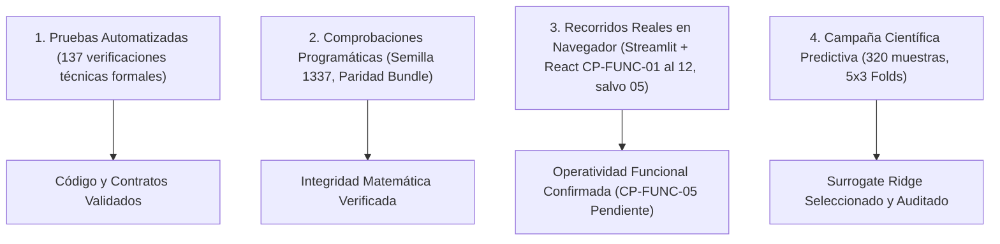

# Documento de Transferencia Técnica: Resumen de Cambios Respecto a `main`

**Proyecto:** Gemelo Digital Agroecológico para la Gestión de Polinizadores  
**Rama de Trabajo:** `revision-metodologica`  
**Base Histórica de Referencia:** Commit [`1ab7c02abc4176d8ec11c94db6e15c80a885f6ab`](https://github.com/JMarkoFlores/gemelo-digital-polinizadores/commit/1ab7c02abc4176d8ec11c94db6e15c80a885f6ab) (*"AFINANDO"*, 2026-10-27)  
**Fecha de Elaboración:** 2026-11-01  
**Audiencia Objetivo:** Integrantes del equipo de desarrollo e investigación que conocen la arquitectura inicial de las Fases 1 a 4 pero no participaron en las auditorías metodológicas ni en la ejecución de la campaña experimental.

---

## A. Resumen para el Compañero

### 1. ¿Qué se hizo en esta revisión?
Durante las fases previas del proyecto (reflejadas en el commit `1ab7c02` de `main`), se consolidó un prototipo funcional con backend FastAPI, frontend React y una interfaz de entrenamiento en Streamlit. No obstante, una auditoría metodológica rigurosa identificó defectos científicos y operacionales críticos que invalidaban el reporte de métricas predictivas y la reproducibilidad editorial:
1. **Fuga de datos (*data leakage*):** El preprocesamiento escalaba la totalidad de las etiquetas objetivo antes de particionar los folds.
2. **Evaluación no anidada:** La sintonización estocástica de hiperparámetros (*tuning*) se aplicaba sobre el dataset completo antes de la validación cruzada.
3. **Incoherencia física:** Las coberturas del suelo (`crop_area_pct`, `natural_area_pct`, `floral_strips_pct`) podían sumar más del 100% de la parcela (hasta 142%).
4. **Desacoplamiento del bundle:** El backend solo podía cargar redes Keras `.h5`, forzando la exportación del mejor fold de Keras e ignorando al verdadero ganador global del benchmark (ej. Ridge Regression), mientras grababa marcadores ficticios `0.0` para RMSE y $R^2$.
5. **Afirmaciones infundadas en UI:** Se garantizaba *"Validez ecológica asegurada"* o *"Hipótesis comprobada"* ante simples guardarraíles operativos heurísticos.

Para solucionar estos defectos sin alterar la copia histórica, se creó un núcleo científico desacoplado ([`scientific_core/`](../../scientific_core/)), una interfaz de línea de comandos reproducible ([`cli.py`](../../cli.py)), un entorno de ejecución Docker aislado (`polinizadores_validacion`), se adaptaron el backend, el frontend y Streamlit, se diseñaron 137 pruebas automatizadas y se ejecutó una única campaña científica predictiva canónica (320 escenarios, política `corrected_full`, $5 \times 3$ folds anidados).

### 2. Estado Actual del Repositorio
- El código se encuentra totalmente corregido y estabilizado en la rama local `revision-metodologica`.
- Todos los cambios residen como archivos modificados y archivos nuevos sin preparar (*unstaged/untracked*), sin haber creado commits intermedios ni haber hecho merge o push a ramas remotas.
- La base histórica coincide exactamente con el commit `1ab7c02`. La rama remota `origin/develop` se encuentra situada en `ece41e8` (8 de octubre), la cual es ancestro directo de `1ab7c02`. Por consiguiente, existen exactamente 5 commits de diferencia entre ambas (`git rev-list --count origin/develop..revision-metodologica = 5` previo al commit de la revisión), correspondientes a la evolución histórica que ya formaba parte de `main`.

### 3. ¿Qué debes leer primero?
Para orientarte de manera eficiente, sigue este orden de lectura:
1. **Este documento:** Comprende la visión global antes/después y el mapa de archivos.
2. [`METODOLOGIA_IMPLEMENTADA.md`](METODOLOGIA_IMPLEMENTADA.md): Detalla los 13 hallazgos de auditoría originales y su solución técnica.
3. [`DECISIONES.md`](DECISIONES.md): Registro cronológico de las 50 decisiones técnicas y de diseño (D001 a D050).
4. [`ESTADO_IMPLEMENTACION.md`](ESTADO_IMPLEMENTACION.md): Bitácora de verificación de pruebas y casos funcionales (CP-FUNC-01 al 12).
5. [`PROTOCOLO_CAMPANA.md`](../../artifacts/revision_metodologica/campana_cientifica/PROTOCOLO_CAMPANA.md), [`INFORME_CAMPANA_CIENTIFICA.md`](../../artifacts/revision_metodologica/campana_cientifica/INFORME_CAMPANA_CIENTIFICA.md) y [`ADENDA_DIAGNOSTICO_CAMPANA.md`](../../artifacts/revision_metodologica/campana_cientifica/ADENDA_DIAGNOSTICO_CAMPANA.md): Documentos formales de la campaña predictiva ejecutada.

---

## B. Comparación Antes / Después

A continuación se contrastan los comportamientos del repositorio entre la base histórica (`1ab7c02`) y la revisión actual:

| Componente | Comportamiento Anterior (`1ab7c02`) | Comportamiento Actual (`revision-metodologica`) | Motivo del Cambio | Rutas Relevantes | Evidencia Disponible |
| :--- | :--- | :--- | :--- | :--- | :--- |
| **1. Generación y auditoría de datos** | Muestreo independiente de coberturas (`crop`: 35–82%, `natural`: 8–42%, `floral`: 2–18%) cuya suma alcanzaba hasta el 142%. Sin auditoría de integridad física de coberturas. | Muestreo condicionado estricto donde $\text{crop} \le 100 - \text{natural} - \text{floral}$. Función `audit_dataset` que verifica cobertura $\le 100\%$, tipos numéricos, nulos, infinitos y duplicados. | Violación de leyes biofísicas de exclusión espacial (H10). | [`scientific_core/contracts.py`](../../scientific_core/contracts.py)<br>[`scientific_core/generator.py`](../../scientific_core/generator.py)<br>[`scientific_core/data_audit.py`](../../scientific_core/data_audit.py) | Suite [`tests/revision/test_t02_data_integrity.py`](../../tests/revision/test_t02_data_integrity.py)<br>Auditoría [`artifacts/revision_metodologica/campana_cientifica/auditoria_dataset_320.json`](../../artifacts/revision_metodologica/campana_cientifica/auditoria_dataset_320.json) |
| **2. Simulación de agentes y objetivos** | Enriquecimiento ABM heterogéneo: solo las primeras 120 filas recibían Mesa ABM; filas 121–320 tenían solo base analítica sin documentar la discontinuidad. Diversidad calculada con fórmulas distintas. | Política explícita `corrected_full` (100% de filas con simulación Mesa en campaña). Diversidad de paisaje unificada mediante `calculate_landscape_diversity(natural, floral, soil)` idéntica en generador, optimizador e inferencia. | Discontinuidad arbitraria en datos (H11) y discrepancia en cálculo de diversidad (H06). | [`streamlit_app/pollinator_abm.py`](../../streamlit_app/pollinator_abm.py)<br>[`scientific_core/generator.py`](../../scientific_core/generator.py)<br>[`scientific_core/contracts.py`](../../scientific_core/contracts.py) | Suite [`tests/revision/test_strict_no_fallbacks.py`](../../tests/revision/test_strict_no_fallbacks.py)<br>Metadatos [`artifacts/revision_metodologica/campana_cientifica/dataset_320_corrected_full.json`](../../artifacts/revision_metodologica/campana_cientifica/dataset_320_corrected_full.json) |
| **3. Evaluación predictiva y fuga** | Escalado global de salidas `y` antes del split de folds (`advanced_training.py:66-67`). Tuning ejecutado sobre todo el dataset. EarlyStopping monitoreaba el fold de prueba externo. | Validación cruzada anidada (*Nested CV*): 5 outer folds $\times$ 3 inner folds. Escaladores ajustados **exclusivamente** con train autorizado. Monitor split interno (20%) para EarlyStopping. `GroupKFold` para evitar fuga por duplicados. | Fuga de información (*data leakage*) severa en salidas y optimismo en selección (H01, H02, H03). | [`scientific_core/nested_cv.py`](../../scientific_core/nested_cv.py)<br>[`streamlit_app/advanced_training.py`](../../streamlit_app/advanced_training.py) | Suites [`tests/revision/test_t04_t05_t06_leakage_checks.py`](../../tests/revision/test_t04_t05_t06_leakage_checks.py)<br>Artefacto [`artifacts/revision_metodologica/campana_cientifica/run_20261029_153857/splits.json`](../../artifacts/revision_metodologica/campana_cientifica/run_20261029_153857/splits.json) |
| **4. Selección y exportación del modelo** | Exportaba forzosamente la red Keras `.h5` del mejor fold individual, aunque Ridge o Random Forest hubieran ganado el benchmark. Marcaba RMSE y $R^2$ en `0.0` ficticio en metadatos. | Selección determinista por menor Macro MAE en escala original. Reajuste agregado final. Predictor universal (`UniversalSurrogatePredictor`) que soporta Scikit-Learn, XGBoost y Keras con paridad predictiva verificada. | Desacoplamiento entre modelo desplegado y modelo ganador; métricas falsas (H04, H05). | [`scientific_core/model_bundle.py`](../../scientific_core/model_bundle.py)<br>[`streamlit_app/export_helpers.py`](../../streamlit_app/export_helpers.py) | Suite [`tests/revision/test_t10_t11_model_bundle.py`](../../tests/revision/test_t10_t11_model_bundle.py)<br>Bundle [`artifacts/revision_metodologica/campana_cientifica/bundle_ridge_campana/`](../../artifacts/revision_metodologica/campana_cientifica/bundle_ridge_campana/) |
| **5. Optimización y validación del dominio** | NSGA-II evaluaba candidatos sin verificar si caían en el dominio multivariado observado en el entrenamiento. Etiquetaba *"Hipótesis comprobada"* ante cumplimiento de un umbral arbitrario. | Control de dominio observado en el dataset sintético de entrenamiento (`observed_training_ranges`). Sustitución de narrativa por *"Criterio operativo cumplido"*. Normalización de objetivos y manejo estricto de escenarios no dominados. | Afirmaciones científicas desmedidas basadas en heurísticas operativas (H08, H13). | [`backend/app/services/optimization.py`](../../backend/app/services/optimization.py)<br>[`backend/app/schemas.py`](../../backend/app/schemas.py) | Suite [`tests/revision/test_t12_to_t15_optimization_domain.py`](../../tests/revision/test_t12_to_t15_optimization_domain.py)<br>Acta CP-FUNC-03 en historial (local) |
| **6. Backend, recarga y narrativa** | `lifespan` cargaba solo archivo fijo `modelo_optimizado.h5`. Fallo silencioso o caída de API si el modelo era Scikit-Learn. Respuestas de chat no auditadas. | `ModelStore` refactorizado para detectar y cargar bundles universales (`bundle_metadata.json`, `scalers.pkl`, `.pkl`/`.h5`). Endpoint `/api/model/reload` y `/api/model/status` autenticados. Chat endurecido. | Incompatibilidad con modelos no Keras y fragilidad en despliegue. | [`backend/app/services/model_store.py`](../../backend/app/services/model_store.py)<br>[`backend/app/main.py`](../../backend/app/main.py)<br>[`backend/app/services/chat_service.py`](../../backend/app/services/chat_service.py) | Validación funcional CP-FUNC-02 verificada en contenedor backend |
| **7. Frontend, historial e informes** | Interfaz mostraba etiquetas de *"Validez ecológica asegurada"* y *"Válido para cualquier parcela"*. Expresiones Word/PDF generaban tipos MIME `undefined` en imágenes. | Etiquetas corregidas a *"Ámbito regional (Sin restricción técnica de coordenadas; no implica validez agronómica universal)"*. Exportadores de Word/PDF con detección de magic bytes PNG (`\x89PNG`). | Confusión entre límites de software y validez agronómica; fallas de empaquetado en reportes. | [`frontend/src/components/MapSelectionCard.jsx`](../../frontend/src/components/MapSelectionCard.jsx)<br>[`frontend/src/lib/generalReportExporters.js`](../../frontend/src/lib/generalReportExporters.js)<br>[`frontend/src/pages/ClientOptimizePage.jsx`](../../frontend/src/pages/ClientOptimizePage.jsx) | Reporte Word renderizado nativamente en Word 2016 y validado visualmente (CP-FUNC-11) |
| **8. Streamlit y exportaciones** | `st.download_button` fallaba por reinicio de `session_state` ante re-ejecución. Exportador no garantizaba que el modelo correspondiera al dataset en pantalla. | Persistencia basada en identidad por hash de contenido SHA-256 (`active_dataset_identity`). Invalida resultados solo cuando los datos cambian. Exportación vinculada a runs. | Pérdida de resultados al cambiar de pestaña e inconsistencia de exportación. | [`streamlit_app/app.py`](../../streamlit_app/app.py)<br>[`streamlit_app/adapter.py`](../../streamlit_app/adapter.py)<br>[`streamlit_app/export_helpers.py`](../../streamlit_app/export_helpers.py) | Prueba funcional CP-FUNC-01A y CP-FUNC-02 en navegador |
| **9. CLI, Docker y configuraciones** | `docker-compose.yml` usaba `container_name` fijos y puertos por defecto que colisionaban con otras instancias. Sin CLI desacoplada para reproducir experimentos. | Parametrización completa de puertos (5433, 8001, 5174, 8502) en Compose. Dockerfile científico específico. CLI desacoplada [`cli.py`](../../cli.py) con subcomandos `audit-data`, `generate-data`, `evaluate`, `export-model`, etc. | Imposibilidad de ejecutar pruebas aisladas sin afectar entornos activos (H09). | [`cli.py`](../../cli.py)<br>[`docker-compose.yml`](../../docker-compose.yml)<br>[`docker-compose.validacion.yml`](../../docker-compose.validacion.yml)<br>[`Dockerfile.scientific`](../../Dockerfile.scientific) | Verificación de configuración Compose aislada y ejecución canónica del CLI en Docker |
| **10. Pruebas y trazabilidad** | Pruebas estadísticas pareadas de Friedman/Nemenyi aplicadas sobre predicciones OOF concatenadas tratando filas dependientes como independientes (H12). | Suite desacoplada en `tests/revision/` (132 pruebas unitarias/integración en Python + 5 en Node.js en informe de auditoría; 142 tests python en la suite final). Manifiestos con SHA-256 en cada ejecución y persistencia de particiones. | Carencia de cobertura de pruebas unitarias sobre contratos científicos y trazabilidad. | [`tests/revision/`](../../tests/revision/)<br>[`scientific_core/persistence.py`](../../scientific_core/persistence.py) | 137 ejecuciones históricas documentadas (132 pytest + 5 Node); no constituye certificación estática de que todo archivo actual fue re-probado |

*Nota sobre verificabilidad histórica:* Todos los comportamientos anteriores indicados fueron confirmados mediante inspección estática del código en el commit `1ab7c02` y contrastados con los informes técnicos de auditoría.

---

## C. Archivos Principales

> [!IMPORTANT]
> **Disponibilidad de Enlaces y Ámbito de Publicación:**
> Los enlaces a código fuente, configuraciones, documentación y suites de pruebas ([`scientific_core/`](../../scientific_core/), [`cli.py`](../../cli.py), [`configs/`](../../configs/), [`tests/revision/`](../../tests/revision/), [`docs/`](./)) corresponden a archivos que formarán parte del repositorio Git remoto en GitHub.
> Por el contrario, los enlaces que apuntan a evidencias binarias pesadas de validación (`artifacts/revision_metodologica/validacion_funcional/` con capturas PNG y PDFs de 22.8 MB) y al paquete ZIP consolidado son **evidencias exclusivamente locales**, preservadas en la estación de trabajo y/o en el paquete independiente de auditoría para evitar la sobrecarga del historial de Git. Dichos enlaces solo resolverán localmente.

Todos los enlaces a continuación utilizan **rutas relativas** desde este documento:

### 1. Núcleo Científico Metodológico (Nuevos)
- [`scientific_core/__init__.py`](../../scientific_core/__init__.py): Inicializador del paquete científico.
- [`scientific_core/contracts.py`](../../scientific_core/contracts.py): Definición de las 8 entradas, 3 objetivos, rangos biofísicos y función unificada de diversidad.
- [`scientific_core/data_audit.py`](../../scientific_core/data_audit.py): Motor de auditoría de datos, detección de duplicados, cálculo de rangos y procedencia veraz.
- [`scientific_core/generator.py`](../../scientific_core/generator.py): Generador de datos sintéticos con garantía física de exclusión de coberturas ($\le 100\%$) y políticas ABM.
- [`scientific_core/nested_cv.py`](../../scientific_core/nested_cv.py): Motor de validación cruzada anidada sin contaminación (Nested CV, KFold y GroupKFold).
- [`scientific_core/model_bundle.py`](../../scientific_core/model_bundle.py): Wrapper `UniversalSurrogatePredictor`, exportación y validación de bundles universales.
- [`scientific_core/persistence.py`](../../scientific_core/persistence.py): Gestor de artefactos (`manifest.json`, `splits.json`, `SHA256SUMS.txt`).

### 2. Herramientas CLI y Configuraciones (Nuevos)
- [`cli.py`](../../cli.py): CLI desacoplada para auditoría, generación, evaluación predictiva, reconstrucción de métricas y exportación.
- [`configs/revision_metodologica.json`](../../configs/revision_metodologica.json): Especificación canónica y congelada de la campaña predictiva multimodelo.
- [`configs/smoke_test.json`](../../configs/smoke_test.json): Configuración rápida desacoplada para pruebas de humo técnicas.
- [`Dockerfile.scientific`](../../Dockerfile.scientific): Definición de contenedor reproducible para el entorno científico.
- [`requirements-scientific.txt`](../../requirements-scientific.txt): Dependencias congeladas para evaluación y auditoría.
- [`docker-compose.validacion.yml`](../../docker-compose.validacion.yml): Override de puertos y volúmenes para aislamiento local.
- [`.env.revision.example`](../../.env.revision.example): Plantilla de variables de entorno para el stack aislado.

### 3. Servicios y Aplicaciones (Modificados)
- **Backend:**
  - [`backend/app/main.py`](../../backend/app/main.py): Lifespan con recarga dinámica y endpoints `/api/model/*`.
  - [`backend/app/services/model_store.py`](../../backend/app/services/model_store.py): Soporte de bundles universales Scikit-Learn/Keras.
  - [`backend/app/services/optimization.py`](../../backend/app/services/optimization.py): Optimización multiobjetivo con verificación de dominio de entrenamiento.
  - [`backend/app/services/chat_service.py`](../../backend/app/services/chat_service.py): Rutas de contingencia y contexto auditado para el asistente IA.
  - [`backend/app/services/report_general_service.py`](../../backend/app/services/report_general_service.py): Métricas operativas y agregación de reportes.
- **Frontend:**
  - [`frontend/src/components/MapSelectionCard.jsx`](../../frontend/src/components/MapSelectionCard.jsx): Corrección de advertencias sobre límites territoriales.
  - [`frontend/src/pages/ClientOptimizePage.jsx`](../../frontend/src/pages/ClientOptimizePage.jsx): Separación entre límites técnicos y validez agronómica.
  - [`frontend/src/lib/generalReportExporters.js`](../../frontend/src/lib/generalReportExporters.js): Exportación Word/PDF con detección de magic bytes PNG.
- **Streamlit App:**
  - [`streamlit_app/app.py`](../../streamlit_app/app.py): Caché de datos por hash de contenido SHA-256 e integración del adaptador.
  - [`streamlit_app/adapter.py`](../../streamlit_app/adapter.py) *(Nuevo)*: Adaptador entre la UI de Streamlit y el core científico.
  - [`streamlit_app/export_helpers.py`](../../streamlit_app/export_helpers.py): Exportación universal vinculada a corridas.
  - [`streamlit_app/pollinator_abm.py`](../../streamlit_app/pollinator_abm.py): Parámetros deterministas de simulación Mesa.

### 4. Pruebas y Suites de Verificación (Nuevos)
- [`tests/revision/`](../../tests/revision/): 38 archivos con 132 pruebas unitarias y de integración en pytest que cubren integridad de datos, aislamiento de folds, early stopping, paridad de inferencia y algoritmos de selección.

### 5. Documentación de Auditoría y Campaña (Nuevos)
- [`PLAN_REVISION_METODOLOGICA.md`](../../PLAN_REVISION_METODOLOGICA.md): Plan de trabajo original de la revisión.
- [`CONTINUIDAD_VALIDACION_LOCAL_POLINIZADORES.md`](../../CONTINUIDAD_VALIDACION_LOCAL_POLINIZADORES.md): Guía de validación local paso a paso.
- [`docs/revision_metodologica/`](./): Directorio con las actas de auditoría, bitácora de implementación y registro de decisiones.

---

## D. Verificaciones Realizadas

El proyecto fue sometido a cuatro niveles complementarios de verificación, cuyos resultados y evidencias se encuentran documentados:



### 1. Pruebas Automatizadas (Ejecuciones Históricas Documentadas)
- **132 pruebas en Python (`tests/revision/`):** Ejecutadas históricamente dentro del contenedor Docker oficial y registradas en el log de auditoría (`INFORME_CORRECCIONES_AUDITORIA_07.md`: `132 passed in 105.12s`). Cubren:
  - T02: Integridad de datos y coberturas biofísicas $\le 100\%$.
  - T04/T05/T06: Fuga de datos, ajuste de escaladores exclusivo en train y aislamiento de folds.
  - T07/T08/T09: Matriz OOF completa y reconstrucción matemática de métricas.
  - T10/T11: Integridad y paridad numérica exacta de bundles de modelos.
  - T12/T15: Control de dominio de inferencia en optimización NSGA-II.
- **5 pruebas en Node.js (`mock_deps.mjs`):** Verificación de estructuras de exportación Excel y formateadores en frontend.
- **Registro histórico documentado:** 137 ejecuciones técnicas documentadas en el informe de auditoría. *Nota de rigor:* Este registro describe las ejecuciones históricas formales documentadas; no constituye una certificación estática de que todos los archivos del repositorio actual fueron re-probados simultáneamente en esta fase.
- *Nota sobre cobertura extendida en disco:* El directorio `tests/revision/` contiene 142 funciones de test en Python (41 archivos), al haberse incorporado 10 verificaciones complementarias sobre contratos biofísicos y frontera de optimización durante las fases posteriores.

### 2. Comprobaciones Programáticas
- **Propagación estocástica (CP-FUNC-01B):** Verificación en corrida `streamlit_scientific_20261029_012835` de que una semilla personalizada (1337) altera la estocasticidad en modelos neuronales y ensambles, manteniendo la invarianza analítica de Ridge.
- **Paridad exacta de inferencia (CP-FUNC-02):** Comprobación matemática de concordancia determinista entre dos lectores independientes del bundle (`ModelStore` de FastAPI vs `load_bundle` del core científico) sobre el vector sintético de referencia, con discrepancia numérica absoluta de $\text{diff} = 0.0$.

### 3. Recorridos Reales en Navegador Web (Validación Funcional CP-FUNC)
Ejecutados interactivamente mediante **Google Chrome asistido por Chrome DevTools MCP nativo de Antigravity** contra el stack Docker aislado:
- **Streamlit:** Entrenamiento interactivo exitoso (CP-FUNC-01A) y exportación de modelo (CP-FUNC-02).
- **Frontend React:** Optimización con frente de Pareto de 64 soluciones (CP-FUNC-03), guardarraíles de validación ante entradas inválidas (CP-FUNC-04), historial cliente (CP-FUNC-06), interacción con chat (CP-FUNC-07), y reportes operativos y agroecológicos con exportaciones reales en Excel, Word y PDF (CP-FUNC-08 al CP-FUNC-12).
- **CP-FUNC-05 (Ausencia de Solución / Escenario Infactible):** Clasificado formalmente en acta como **PENDIENTE DE REPRODUCCIÓN FUNCIONAL DEL ESTADO SIN SOLUCIÓN**. La lógica de control en backend (`status: "infeasible"`) está implementada y cubierta por pruebas unitarias, pero en los intentos de frontera interactivos el optimizador devolvió frentes factibles (64 y 61 alternativas), por lo que no se forzó un mock ni se pudo visualizar en pantalla la condición vacía.
- **Nota sobre evidencias de validación funcional:** Los reportes generados (.docx de 152 KB, .xlsx de 32 KB, PDFs vectoriales de 6.35 MB y 14 capturas PNG) se encuentran preservados en el directorio local `artifacts/revision_metodologica/validacion_funcional/` (22.26 MB) y en el ZIP consolidado (890 KB). **Estas evidencias binarias pesadas son exclusivamente locales y no se incluirán en el repositorio Git remoto**, estando su autenticidad certificada en las actas de auditoría correspondientes.

### 4. Campaña Científica Predictiva
Evaluación formal y canónica del prototipo ejecutada mediante la CLI sobre el dataset congelado de 320 muestras, descrita en el siguiente apartado.

---

## E. Campaña Científica Conservada

La campaña predictiva formal se encuentra completamente organizada y preservada bajo [`artifacts/revision_metodologica/campana_cientifica/`](../../artifacts/revision_metodologica/campana_cientifica/):

### 1. Parámetros Metodológicos Congelados
- **Dataset:** [`dataset_320_corrected_full.csv`](../../artifacts/revision_metodologica/campana_cientifica/dataset_320_corrected_full.csv) (320 filas, 14 columnas, SHA-256: `0467f8ba1f04c6b9b5d5947074479acada6fdc259029219224e2bf1b4b7abb64`).
- **Política ABM:** `corrected_full` (100% de las 320 filas enriquecidas mediante simulación en cuadrícula de Mesa de $18 \times 18$, 30 pasos, semillas deterministas $42 + i$).
- **Exclusión de datos públicos:** **La campaña NO utilizó consultas de red a GBIF ni a NASA POWER.** La justificación científica es doble: 1) Ni GBIF ni NASA miden los índices objetivo simulados (`crop_yield_index`, `pollinator_abundance_index`, `pollinator_diversity_index`), actuando en modo público solo como parámetros de distribución gaussiana u offsets basales; y 2) Evitar variaciones o latencias externas no reproducibles.
- **Diseño de CV:** Validación cruzada anidada con 5 outer folds (GroupKFold por duplicados) $\times$ 3 inner folds para selección de hiperparámetros.

### 2. Resultados Predictivos y Modelo Ganador (Run Canónico `run_20261029_153857`)
Valores extraídos directamente de los artefactos oficiales ([`model_summary.csv`](../../artifacts/revision_metodologica/campana_cientifica/run_20261029_153857/model_summary.csv) y [`tabla_comparativa_modelos.csv`](../../artifacts/revision_metodologica/campana_cientifica/tabla_comparativa_modelos.csv)):

| Modelo (*Surrogate*) | CV Macro MAE | CV Macro RMSE | CV Macro $R^2$ | OOF Macro MAE | OOF Macro RMSE | OOF Macro $R^2$ | Tiempo Train Re-fit (s) | Tiempo Infer (s, $N=1$) |
| :--- | :---: | :---: | :---: | :---: | :---: | :---: | :---: | :---: |
| **Ridge Regression** 🏆 | **$1.288 \pm 0.117$** | **$1.651 \pm 0.168$** | **$0.978 \pm 0.006$** | **1.288** | **1.661** | **0.979** | **0.0012** | **0.00010** |
| **Deep Neural Net (DNN)** | $1.713 \pm 0.109$ | $2.145 \pm 0.099$ | $0.966 \pm 0.004$ | 1.713 | 2.152 | 0.966 | 2.0650 | 0.06459 |
| **Bottleneck MLP (AE)** | $1.766 \pm 0.121$ | $2.232 \pm 0.132$ | $0.963 \pm 0.005$ | 1.766 | 2.239 | 0.964 | 2.2277 | 0.07455 |
| **XGBoost Regressor** | $2.311 \pm 0.223$ | $2.868 \pm 0.237$ | $0.939 \pm 0.011$ | 2.311 | 2.886 | 0.940 | 0.0789 | 0.00051 |
| **Random Forest** | $3.112 \pm 0.258$ | $3.876 \pm 0.314$ | $0.890 \pm 0.012$ | 3.112 | 3.894 | 0.890 | 0.1875 | 0.00215 |

- **Matriz OOF:** [`oof_predictions.csv`](../../artifacts/revision_metodologica/campana_cientifica/run_20261029_153857/oof_predictions.csv) auditada con exactamente $5 \text{ familias} \times 3 \text{ salidas} \times 320 \text{ filas} = 4.800$ filas, 0 duplicados y 0 valores nulos.
- **Métrica Primaria OOF del Ganador:** Macro MAE global fuera de muestra (*out-of-fold*) = **$1.288445$** (reportado como $1.288$ en tabla y verificado en [`model_summary.csv`](../../artifacts/revision_metodologica/campana_cientifica/run_20261029_153857/model_summary.csv)).
- **Modelo Ganador Seleccionado:** **Ridge Regression** con parámetro consolidado $\alpha = 0.1$ (seleccionado deterministamente por menor Macro MAE en la agregación de folds internos).
- **Bundle Universal Exportado:** [`bundle_ridge_campana/bundle_ridge_078f18a6664f`](../../artifacts/revision_metodologica/campana_cientifica/bundle_ridge_campana/bundle_ridge_078f18a6664f), validado exitosamente con predicción determinista de prueba $[86.3886, 104.5473, 32.3185]$.
- **Diferencia Fundamental:** La evaluación predictiva mide la fidelidad del modelo sustituto frente al simulador *in-silico*; las pruebas funcionales verificaron que los flujos de software (UI, APIs, base de datos) operan sin errores técnicos.

---

## F. Limitaciones y Pendientes

El compañero que asuma este trabajo debe tener presentes las siguientes restricciones metodológicas:

1. **Saturación del ABM de Abundancia en 120:**
   - En [`dataset_320_corrected_full.csv`](../../artifacts/revision_metodologica/campana_cientifica/dataset_320_corrected_full.csv), la columna `abm_pollinator_abundance` vale **$120.0$ en el 100% de las 320 filas**.
   - Causa: El generador aplicó `clip(mean_population * 1.25, 8, 120)` sobre poblaciones brutas que oscilaron entre 290 y 680 agentes en el simulador.
   - Consecuencia: La contribución del ABM a la abundancia colapsó a un **desfase aditivo constante de $+78.0$** ($0.65 \times 120.0$). La variación del índice en el dataset provino exclusivamente de la ecuación analítica base.
2. **Naturaleza Analítica de la Diversidad y Distinción de Conceptos:**
   - **Índice de Paisaje (`landscape_diversity`):** Parámetro de entrada sintético calculado mediante `calculate_landscape_diversity(natural, floral, soil)` a partir de coberturas de suelo, acotado en $[0, 1]$. Es un índice de configuración espacial, no biológico.
   - **Expresión Analítica del Simulador ABM (`abm_pollinator_diversity`):** El método `run()` de `PollinatorLandscapeModel` no modela especies ni interacciones ecológicas emergentes, sino una combinación lineal algebraica determinista sobre las variables del paisaje:
     $$\text{diversity} = \text{clip}(8 + 0.38 \cdot \text{natural\_area\_pct} + 0.55 \cdot \text{floral\_strips\_pct} + 14 \cdot \text{landscape\_diversity} - 0.08 \cdot \text{pesticide\_level}, 4, 55)$$
   - **Objetivo Final (`pollinator_diversity_index`):** Se construye en el pipeline como una ponderación lineal con ruido:
     $$\text{pollinator\_diversity\_index} = 0.3 \cdot \text{diversidad\_analítica\_base} + 0.7 \cdot \text{abm\_pollinator\_diversity}$$
   - **Inexistencia de Diversidad Taxonómica Emergente o Shannon:** No se computa entropía de Shannon ($H' = -\sum p_i \ln p_i$) ni abundancia relativa de múltiples taxones en el código. No debe presentarse como biodiversidad taxonómica emergente.
3. **Ausencia de Validación de Campo:**
   - Los datos son sintéticos calibrados. **No existe validación agronómica empírica en parcelas reales** ni anclaje geográfico verificable en el Valle del Cauca (la etiqueta `"Valle del Cauca"` inyectada en los metadatos del bundle es un texto fijo de la CLI que carece de respaldo territorial). El rango admisible corresponde al **dominio observado en el dataset sintético** (`observed_training_ranges`), no a un soporte de campo.
4. **Ausencia de Campaña Científica de Optimización:**
   - No se ejecutó una campaña experimental de optimización multiobjetivo con casos de prueba formales; dicho diseño experimental permanece pendiente.
5. **Casos Funcionales Pendientes:**
   - **CP-FUNC-05:** Permanece clasificado formalmente como **PENDIENTE de reproducción funcional interactiva del estado sin solución** en el optimizador NSGA-II. La lógica de rechazo en backend (`status: "infeasible"`) está programada y respaldada por pruebas unitarias, pero en los dos recorridos interactivos con parámetros extremos el optimizador devolvió frentes factibles (64 y 61 alternativas), por lo que no se forzó un mock ni se reprodujo en pantalla la condición vacía.
   - **Rutas de fallo:** Quedan pendientes las ramas de contingencia ante caídas de red del chat y vistas de reportes vacías con cero escenarios evaluables.

---

## G. Cómo Continuar

Para levantar y verificar el entorno sin alterar la campaña existente:

### 1. Preparación del Entorno
1. Copia el archivo de variables de ejemplo:
   ```bash
   cp .env.revision.example .env
   ```
2. Revisa que `.env` tenga valores de prueba seguros (ej. contraseñas de desarrollo locales).
3. Levanta el stack aislado de validación:
   ```bash
   docker compose -p polinizadores_validacion -f docker-compose.yml -f docker-compose.validacion.yml up -d --build
   ```

### 2. Identificación de Configuraciones
- Para verificar el pipeline en modo rápido (smoke test):
  - Archivo: [`configs/smoke_test.json`](../../configs/smoke_test.json)
- Para la especificación canónica formal de la campaña:
  - Archivo: [`configs/revision_metodologica.json`](../../configs/revision_metodologica.json)

### 3. Operación con la CLI (`cli.py`): Separación de Subcomandos

> [!CAUTION]
> **Distingue entre subcomandos de lectura/verificación y subcomandos de entrenamiento/ejecución activa.**  
> El subcomando `evaluate` **NO es de consulta**: ejecuta un ciclo completo de validación cruzada anidada multimodelo y reentrenamiento. Para consultar la campaña existente sin modificarla, utiliza **únicamente** los subcomandos de lectura.

#### A. Subcomandos de Lectura, Consulta y Verificación (Sin Reentrenamiento)
Estos comandos leen artefactos congelados, verifican contratos o reconstruyen métricas sin entrenar modelos ni invocar simuladores:
- **Reconstruir métricas OOF a partir de predicciones ya guardadas:**
  ```bash
  python cli.py recompute-metrics --oof artifacts/revision_metodologica/campana_cientifica/run_20261029_153857/oof_predictions.csv
  ```
- **Validar la integridad, firmas y hashes de un bundle exportado:**
  ```bash
  python cli.py validate-bundle --bundle-dir artifacts/revision_metodologica/campana_cientifica/bundle_ridge_campana/bundle_ridge_078f18a6664f
  ```
- **Auditar la integridad biofísica de un dataset CSV:**
  ```bash
  python cli.py audit-data --input artifacts/revision_metodologica/campana_cientifica/dataset_320_corrected_full.csv --policy corrected
  ```

#### B. Subcomandos de Ejecución Activa (Generan Datos o Entrenan Modelos)
Estos comandos realizan cómputo pesado y modifican o generan nuevos artefactos; **no los ejecutes si tu objetivo es solo auditar o consultar la campaña existente**:
- `python cli.py evaluate`: **Ejecuta Nested CV completa** (5 outer $\times$ 3 inner folds, búsqueda de hiperparámetros y ajuste de modelos).
- `python cli.py generate-data`: Genera un nuevo dataset sintético ejecutando simulaciones ABM en Mesa.
- `python cli.py export-model`: Reajusta un modelo final con el dataset completo y serializa el bundle.
- `python cli.py optimize`: Ejecuta el algoritmo genético NSGA-II contra un bundle exportado.
- `python cli.py smoke`: Ejecuta el pipeline reducido sintético de extremo a extremo (T19).

---

## H. Mapa Documental del Repositorio

A continuación se resume el propósito de cada documento clave y su disponibilidad prevista tras la publicación:

| Documento | Ubicación | Ámbito / Disponibilidad | Rol y Contenido Principal |
| :--- | :--- | :--- | :--- |
| **Resumen de Cambios** | [`RESUMEN_CAMBIOS_RESPECTO_MAIN.md`](./RESUMEN_CAMBIOS_RESPECTO_MAIN.md) | **Repositorio Git** | **(Este documento)** Guía de transferencia técnica sobre qué cambió respecto a `main`, por qué se modificó y qué precauciones tomar. |
| **Metodología Implementada** | [`METODOLOGIA_IMPLEMENTADA.md`](./METODOLOGIA_IMPLEMENTADA.md) | **Repositorio Git** | Fundamentación teórica y editorial (AGROSAVIA) de las correcciones matemáticas y de arquitectura. |
| **Registro de Decisiones** | [`DECISIONES.md`](./DECISIONES.md) | **Repositorio Git** | Bitácora cronológica formal de las decisiones D001 a D050 adoptadas durante la revisión. |
| **Estado de Implementación** | [`ESTADO_IMPLEMENTACION.md`](./ESTADO_IMPLEMENTACION.md) | **Repositorio Git** | Estado detallado de los 12 módulos de auditoría y de los casos funcionales CP-FUNC-01 al 12. |
| **Plan Metodológico** | [`PLAN_REVISION_METODOLOGICA.md`](../../PLAN_REVISION_METODOLOGICA.md) | **Repositorio Git** | Plan de auditoría y revisión original que sirvió de hoja de ruta. |
| **Guía de Continuidad** | [`CONTINUIDAD_VALIDACION_LOCAL_POLINIZADORES.md`](../../CONTINUIDAD_VALIDACION_LOCAL_POLINIZADORES.md) | **Repositorio Git** | Instrucciones paso a paso para la validación funcional en el entorno Docker local. |
| **Protocolo de Campaña** | [`PROTOCOLO_CAMPANA.md`](../../artifacts/revision_metodologica/campana_cientifica/PROTOCOLO_CAMPANA.md) | **Artefacto Canónico (Local / En ZIP)** | Protocolo previo vinculante que fijó los 320 escenarios, las 5 familias y los $5 \times 3$ folds anidados. |
| **Informe Científico** | [`INFORME_CAMPANA_CIENTIFICA.md`](../../artifacts/revision_metodologica/campana_cientifica/INFORME_CAMPANA_CIENTIFICA.md) | **Artefacto Canónico (Local / En ZIP)** | Informe definitivo de resultados predictivos, figuras, tiempos y selección de Ridge como ganador. |
| **Adenda de Diagnóstico** | [`ADENDA_DIAGNOSTICO_CAMPANA.md`](../../artifacts/revision_metodologica/campana_cientifica/ADENDA_DIAGNOSTICO_CAMPANA.md) | **Artefacto Canónico (Local / En ZIP)** | Diagnóstico crítico sobre la saturación del ABM a 120, la diversidad analítica y la fe de erratas formal. |
| **Manifiesto de Evidencias** | [`MANIFIESTO_ZIP_EVIDENCIAS.md`](../../artifacts/revision_metodologica/MANIFIESTO_ZIP_EVIDENCIAS.md) | **Artefacto Local (En ZIP)** | Inventario y sumas de verificación SHA-256 del paquete ZIP consolidado para revisión independiente. |
